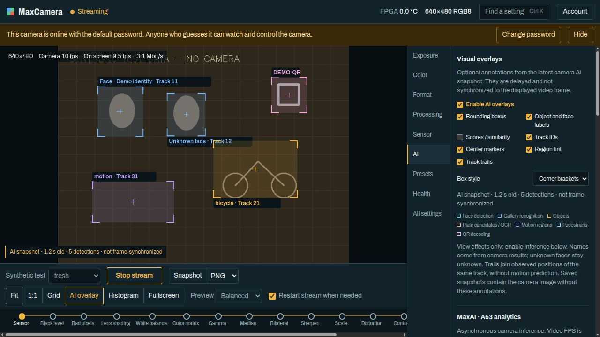
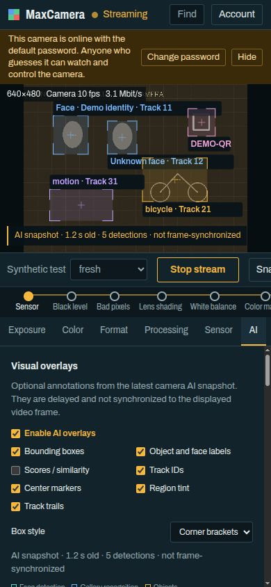

# MaxCameraApp · MaxCamera Control

Authenticated browser control and live preview for the DinxTech MaxCamera GigE Vision camera. English responsive UI, Linux gateway, no third-party frontend JavaScript. The application adds eight MaxAI feature groups, coherent diagnostics/result snapshots, and optional delayed AI visual overlays.



*Actual application UI on an explicitly synthetic test fixture. Scene, identities, detections and results are fabricated for illustration, not real camera footage or evidence of model accuracy. The default-password warning and **Synthetic test** selector belong to the disposable fixture; this selector is absent from the production application.*

## User guide

- [Detailed Russian PDF](docs/MaxCameraApp_User_Guide_RU.pdf)
- [Editable Russian guide](docs/MaxCameraApp_User_Guide_RU.md)
- [AI overlays](docs/AI_VISUALS.md)
- [Earlier bounded AI verification](docs/AI_UPDATE_REPORT.md)
- [Publication checks](docs/PUBLICATION_VERIFICATION.md)
- [Architecture and APIs](docs/ARCHITECTURE.md)
- [Security model](docs/SECURITY.md)
- [Deployment and remote access](docs/DEPLOYMENT.md)
- [Development and testing](docs/DEVELOPMENT.md)

## Local setup

Current backend lockdown requires **Linux x86-64**, the system `/usr/bin/python3` 3.10+ (verified on 3.10), GCC, bubblewrap, gzip, and Python pip. Desktop browsers use standard web features; prior UI verification used Chromium at desktop/mobile widths. Camera firmware/models must be prepared separately.

For Ubuntu/Debian, install the required system packages yourself:

```sh
sudo apt install python3 python3-pip gcc bubblewrap gzip
```

Then from this repository:

```sh
./deploy/bootstrap-local.sh
# Edit deploy/maxcamera.env with the camera's verified MAC and IP.
python3 deploy/discover-camera.py
# Update MAXCAMERA_IP with the discovered address.
./deploy/preview-local.sh
```

Open http://localhost:8081/. First sign-in for a new local state is `admin` / `admin`; change it in **Account** before granting anyone access. The foreground preview uses its own ignored `run/ai-preview/` state and stops when the launcher exits. Do not start a second controller while another app is streaming.

No firmware, models, face gallery, local account data, scene images, installed dependencies or prebuilt platform libraries are distributed here. The bootstrap downloads direct and transitive version-pinned Python packages and builds the local C receiver. It does not touch camera settings, services, router or firewall.

## AI workflow

Start stream → **AI** → choose supported feature groups → **Apply selection**. Enable **Visual overlays** to display corner/rectangle boxes, labels, scores, track IDs, centers, tint and observed trails. The toolbar **AI overlay** toggles browser annotations only.

AI snapshots are asynchronous and **not frame-synchronized**. Age includes inference time. Stale, mismatched, unavailable or stopped results do not draw annotations; the current freshness ceiling is 15 seconds. Browser annotations do not change downloaded camera snapshots, camera registers or saved presets. Scores are model scores, cosine similarity or operational markers, not calibrated confidence. Accuracy and physical MicroSD boot remain unqualified.

The reviewed upstream contract is pinned to [MaxCamera 07dfb588](https://github.com/MaksimNuzhdin/MaxCamera/commit/07dfb588b9576f827968c47c5798d9164561346d), firmware `0.3.16-ai-linux-dev`. Verify its XML with `python3 deploy/update-camera-source.py`.

## Offline checks

JavaScript development checks additionally require Node.js (18+ recommended), which is not needed to run the application. Install it from the official distribution or your OS package manager.

```sh
PYTHONPATH=pydeps:backend python3 -m unittest discover -s tests -v
node tests/test_ai_ui.cjs
node tests/test_ai_visuals.cjs
python3 deploy/update-camera-source.py
```

`tests/check_http_ai.py` requires an already-running preview and a free camera; `--live` adds a bounded hardware test. Never run it against an active user's stream. `tests/preview_ai_visuals.py` provides a labelled synthetic loopback fixture without camera traffic.

## Optional user services

The checked-in service templates assume this repository is at **~/MaxCameraApp**. If it is elsewhere, update `EnvironmentFile` and `ExecStart` in the three `.service` files before copying them into `~/.config/systemd/user/`. Services use port 8080; the separate development preview uses 8081. Installing/enabling user services is a separate manual step. Nothing auto-installs or enables public access.

## Security and rights

Three bubblewrap/seccomp-confined processes separate the HTTP edge, networkless web gateway and fixed-camera bridge. Authenticated users still can view the scene, change supported settings, save presets and reset the camera. Sandboxing reduces access; it is not a guarantee against every bug. Password changes invalidate tokens but do not immediately close already-open WebSockets; restart the web service to force-disconnect existing viewers. Do not expose the default account or use plain HTTP over untrusted networks. Optional remote-access scripts are operator tools and must only be run after reviewing their consequences.

The repository does not assign a new project-wide license. Existing per-file notices and the upstream camera project's rights apply. The bundled Archivo font retains its SIL Open Font License in [frontend/fonts/OFL.txt](frontend/fonts/OFL.txt). Python dependencies are downloaded separately and retain their own licenses.

## Responsive layout



*The same synthetic fixture at 390 × 844 (not real camera footage). On narrow screens the settings panel moves below the preview. Toolbar and processing-chain strips can scroll horizontally.*

[Third-party notices, including PDF fonts](docs/THIRD_PARTY_NOTICES.md).
