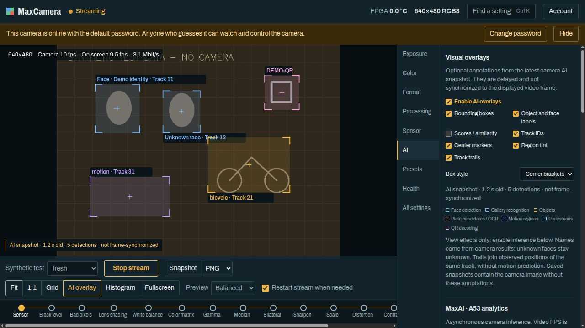
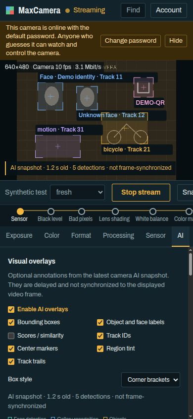

# MaxCameraApp

**MaxCamera Control: управление GigE Vision камерой, живое видео и AI-аннотации в браузере.**

[English](README.en.md) · [PDF user guide](docs/MaxCameraApp_User_Guide_RU.pdf) · [Руководство в Markdown](docs/MaxCameraApp_User_Guide_RU.md) · [Документация](#документация)



*Интерфейс настоящего приложения на синтетическом тестовом стенде. Сцена, имена, детекции и AI-результаты вымышлены; это не съёмка камеры и не доказательство точности моделей. Переключатель **Synthetic test** есть только у стенда. Баннер стандартного пароля относится к его одноразовому состоянию.*

## Что умеет приложение

MaxCameraApp работает локальным Linux-шлюзом между браузером и камерой DinxTech MaxCamera. Интерфейс на английском, руководство пользователя на русском. Для просмотра не нужен браузерный плагин.

| Возможность | Что доступно |
|---|---|
| Живое видео | Старт/стоп, счётчики FPS и потерь, четыре качества браузерного preview |
| Настройки камеры | Экспозиция, усиление, баланс белого, формат, ROI/масштабирование, ISP, сенсор, пресеты и диагностика |
| Навигация | Поиск параметра, вкладки, цепочка обработки изображения, горячие клавиши |
| Просмотр | Fit, 1:1, zoom/pan, сетка, гистограмма, fullscreen, PNG/JPEG snapshot |
| MaxAI | Восемь групп функций, поддерживаемые настройки, состояния worker и целостные снимки результатов |
| Визуальные эффекты | Рамки, подписи, score/similarity, ID трека, центры, заливка и след наблюдений |
| Доступ | Локальная авторизация, разделение процессов через bubblewrap/seccomp, loopback по умолчанию |
| Узкие экраны | Панель параметров переносится под изображение; длинные полосы инструментов прокручиваются |

## Быстрый старт

### 1. Подготовьте Linux-хост

Текущий backend требует **Linux x86-64**, системный **/usr/bin/python3 3.10+** (проверено на 3.10), GCC, bubblewrap, gzip и pip для того же Python. Node.js нужен только разработчику для JS-тестов. Проверка UI выполнялась в Chromium на desktop/mobile размерах; полная матрица других браузеров не квалифицирована.

Пример системных зависимостей для Ubuntu/Debian, устанавливаемых оператором:

```sh
sudo apt install git python3 python3-pip gcc bubblewrap gzip
```

### 2. Получите и соберите проект

```sh
git clone https://github.com/MaksimNuzhdin/MaxCameraApp.git ~/MaxCameraApp
cd ~/MaxCameraApp
./deploy/bootstrap-local.sh
```

Bootstrap скачивает version-pinned зависимости с PyPI в локальную `pydeps/`, собирает C-приёмник, создаёт пример локальной конфигурации при её отсутствии и проверяет XML камеры. Он не запускает сервисы, не меняет firewall/router/account и не обращается к камере.

### 3. Укажите свою камеру

Откройте `deploy/maxcamera.env` и задайте проверенный **MAXCAMERA_MAC**. Затем выполните ограниченное read-only обнаружение:

```sh
/usr/bin/python3 deploy/discover-camera.py
```

Впишите найденный IP в **MAXCAMERA_IP**. Оставьте **MAXCAMERA_LISTEN=127.0.0.1** для локального доступа. Адреса в `.example` намеренно не являются реальными настройками камеры. DHCP-адрес может меняться; не копируйте адрес из старого отчёта.

### 4. Откройте приложение

```sh
./deploy/preview-local.sh
```

Оставьте терминал открытым и перейдите на **http://localhost:8081/**. Для нового preview-состояния начальный вход: **admin / admin**. Смените пароль в **Account**, прежде чем кому-либо давать доступ. Установленный сервис и отдельный preview используют разное локальное состояние.

Нажмите **Start stream**. Для цветного preview можно выбрать **Format → Full-field color preview**. Когда закончили, нажмите **Stop stream**, чтобы освободить камеру. Ctrl+C останавливает только компоненты этого foreground preview.

## AI: от включения до аннотаций

1. Запустите поток. Выберите небольшую нужную группу функций во вкладке **AI**.
2. Нажмите **Apply selection**. Недоступные возможности не следует трактовать как загруженные и проверенные модели.
3. Смотрите состояние worker, error code, latency, configuration generation и возраст результата.
4. В **Visual overlays** включите **Enable AI overlays**, затем нужные эффекты.
5. Кнопка **AI overlay** в toolbar переключает только визуальный слой браузера. Она сама не запускает inference.

| Группа | Назначение и ограничения |
|---|---|
| Face detection | Рамки лиц YuNet |
| Gallery recognition | Сравнение SFace; неизвестное лицо не получает выдуманного имени, пустая gallery возвращает unknown |
| Objects | YOLOX, классы COCO |
| Plate candidates / OCR | Кандидаты номеров/OCR; качество и применимость зависят от данных, не квалифицированы |
| Motion regions | Разница выборочных кадров; свет и движение камеры могут срабатывать как движение |
| Pedestrians | HOG/SVM, отдельно от COCO person |
| QR decoding | Декодированный текст ограничен контрактом камеры |
| Tracking | Нужен хотя бы один detector; след соединяет только наблюдённые точки, без прогноза |

### Важно: AI не синхронизирован с видеокадром

Результат AI приходит асинхронно. Подпись **not frame-synchronized** означает, что рамка не является гарантированной меткой текущего показываемого кадра. Возраст включает inference и продолжает увеличиваться между ответами.

Приложение скрывает аннотации при stale/error/unavailable/disabled, потере связи, остановке, несовпадении геометрии/формата/конфигурации. Текущий предел свежести: **15 секунд**. Настройки AI очищаются при освобождении управления и не включаются автоматически после stop.

**Score не является универсальной уверенностью в процентах:** UI различает model score, cosine similarity и operational marker. Точность распознавания, реальные номера, gallery, endurance и физический MicroSD boot не квалифицированы этой публикацией.

Скачанный **Snapshot** содержит изображение камеры без браузерных AI-аннотаций, сетки и гистограммы. Эффекты не меняют camera registers, сохранённые пресеты или исходное видео.

## Мобильный интерфейс



*Тот же синтетический стенд при размере 390 × 844. Реальных сцен или персональных данных на скриншотах нет. Это иллюстрация адаптивной верстки, не тест точности AI.*

## Документация

| Документ | Для чего |
|---|---|
| [Подробное руководство PDF](docs/MaxCameraApp_User_Guide_RU.pdf) | Пошаговые сценарии, все вкладки, AI/эффекты, аккаунт, эксплуатация и troubleshooting |
| [Исходник руководства](docs/MaxCameraApp_User_Guide_RU.md) | Редактируемая версия на русском |
| [Архитектура и API](docs/ARCHITECTURE.md) | Границы процессов, жизненный цикл камеры, маршруты и AI-integrity |
| [Безопасность](docs/SECURITY.md) | Модель угроз, данные, авторизация и ограничения защиты |
| [Развёртывание](docs/DEPLOYMENT.md) | Конфигурация, systemd, локальный preview, HTTPS/remote access |
| [Разработка](docs/DEVELOPMENT.md) | Сборка, зависимости, offline/live проверки и synthetic fixture |
| [AI visual overlays](docs/AI_VISUALS.md) | Геометрия, trails, состояния и предыдущая UI-проверка |
| [AI update report](docs/AI_UPDATE_REPORT.md) | Закреплённый upstream и предыдущие bounded hardware-проверки |
| [Проверки публикации](docs/PUBLICATION_VERIFICATION.md) | Что прошло, что не запускалось, состав и исключения |

## Проверки разработчика

После bootstrap и установки Node.js (18+ рекомендуется):

```sh
PYTHONDONTWRITEBYTECODE=1 PYTHONPATH=pydeps:backend \
  /usr/bin/python3 -B -m unittest discover -s tests -v
node tests/test_ai_ui.cjs
node tests/test_ai_visuals.cjs
/usr/bin/python3 deploy/update-camera-source.py
bash -n deploy/*.sh
```

Пройдены 22 backend-теста, оба JS-набора, parse/syntax проверки, сверка XML/assets/source hashes, чистая установка зависимостей и сборка/загрузка C-приёмника. Скриншоты иллюстрируют интерфейс и не заменяют аппаратные тесты.

`tests/preview_ai_visuals.py` запускает loopback-only стенд без камеры на порту 8082. `tests/check_http_ai.py` работает с уже запущенным preview; `--live` дополнительно использует камеру в ограниченном 18-секундном тесте. **Не запускайте live-проверку во время чужого стрима.** При публикации активный реальный поток намеренно не прерывался. CI workflow в initial release не настроен.

## Установка постоянного сервиса

Шаблоны в `deploy/systemd/` рассчитаны на путь **~/MaxCameraApp**. Если checkout расположен иначе, измените `EnvironmentFile` и `ExecStart` перед ручной установкой. Установленные сервисы используют порт 8080, отдельный development preview: 8081. Подробные команды и ограничения: [DEPLOYMENT.md](docs/DEPLOYMENT.md).

Не используйте широкие process-name kills для перезапуска: они могут остановить другой preview. Предпочтительны конкретные systemd units или Ctrl+C у собственного preview. Одновременно камерой управляет только одно приложение.

## Что публикуется и что исключено

В Git входят исходники, тесты, документация, XML/provenance, version-lock зависимостей, пример конфигурации и два синтетических скриншота. `SOURCE_MANIFEST.json` сохраняет SHA-256 неизменённых backend/frontend/test-файлов.

**Не публикуются:** `run/`, auth/session state, локальные IP/MAC-настройки, кадры реальной камеры, enrolled identities, модели/веса, `pydeps/`, `vendor/`, `.so`, `.pyc` и caches. Локальные файлы создаются во время настройки и игнорируются Git.

## Безопасность и права

По умолчанию доступ локальный. Три процесса разделены bubblewrap/seccomp, но sandbox не заменяет обновления и не гарантирует защиту от любой ошибки. Все вошедшие пользователи используют один аккаунт, поток и настройки камеры. Смена пароля инвалидирует session tokens, но не разрывает уже открытые WebSocket немедленно; для принудительного отключения всех viewers нужен согласованный restart web-службы.

Не открывайте наружу **admin/admin** и не передавайте пароль/видео по незащищённому HTTP через недоверенную сеть. Туннельный провайдер видит TLS-терминированный трафик. Public-access helpers меняют доступность и некоторые системные настройки; они не нужны для quick start и не запускаются автоматически.

Контракт закреплён за [MaxCamera 07dfb588](https://github.com/MaksimNuzhdin/MaxCamera/commit/07dfb588b9576f827968c47c5798d9164561346d), firmware **0.3.16-ai-linux-dev**. Firmware, camera-side AI runtime, модели, gallery и calibration готовятся отдельно по upstream-процедурам.

Публикация не назначает новую общую лицензию проекту. Сохраняются существующие per-file права и права upstream. Локальный шрифт Archivo сопровождается [SIL Open Font License](frontend/fonts/OFL.txt); отдельно скачиваемые Python-зависимости имеют собственные лицензии.

[Third-party notices, including PDF fonts](docs/THIRD_PARTY_NOTICES.md).
