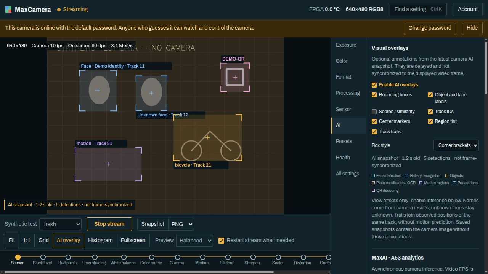
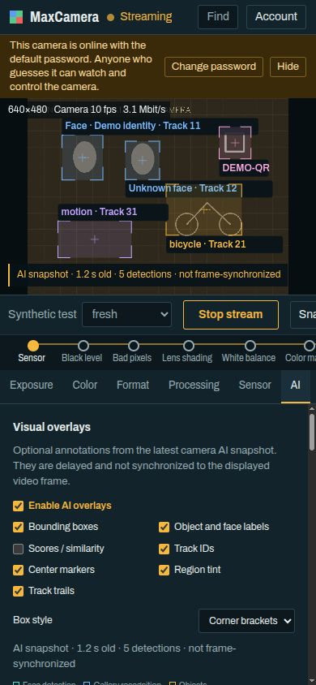

# MaxCameraApp

## User and Administrator Guide

**MaxCamera Control • English edition • 6 November 2026**

Browser-based GigE Vision camera preview, image controls, experimental MaxAI analytics and visual annotations.

Operators: start with chapter 1. For AI, see chapters 11-15. For installation and maintenance, see chapters 17-22.

**Compatibility:** this application targets the DinxTech MaxCamera MAX 5640, OV5640 sensor and ALINX AXU2CGB board. Its feature map is pinned to firmware `0.3.16-ai-linux-dev`. Do not assume that another camera or firmware is compatible merely because it supports GigE Vision.

**Before first use**

- Replace the initial `admin` / `admin` password before granting access to other people or from the internet.
- The camera, stream and settings are shared by everyone signed in. Stopping the stream or using Reset camera affects other operators.
- AI is experimental. Results can be wrong or delayed; FRESH does not mean alignment with the current video frame.
- Begin locally. Internet publication and network changes need separate preparation.

Button and field names match the English interface. Run commands from the project directory unless a different location is stated. Actual feature availability, limits and increments depend on the camera's current state and XML feature map.

<!-- pagebreak -->

# Contents

<!-- toc -->
- [1. Quick start and sign-in](#1-quick-start-and-sign-in)
- [2. Screen and navigation](#2-screen-and-navigation)
- [3. Streaming, quality and statistics](#3-streaming-quality-and-statistics)
- [4. Viewing, zoom and snapshots](#4-viewing-zoom-and-snapshots)
- [5. Changing settings](#5-changing-settings)
- [6. Exposure and Color](#6-exposure-and-color)
- [7. Format: mode, ROI and network](#7-format-mode-roi-and-network)
- [8. Processing: FPGA pipeline](#8-processing-fpga-pipeline)
- [9. Sensor: tests and effects](#9-sensor-tests-and-effects)
- [10. Health and All settings](#10-health-and-all-settings)
- [11. MaxAI: preparation and startup](#11-maxai-preparation-and-startup)
- [12. AI groups: faces, objects and plates](#12-ai-groups-faces-objects-and-plates)
- [13. AI groups: motion, QR and tracks](#13-ai-groups-motion-qr-and-tracks)
- [14. AI settings, states and results](#14-ai-settings-states-and-results)
- [15. AI overlay: annotations on video](#15-ai-overlay-annotations-on-video)
- [16. Presets and shared access](#16-presets-and-shared-access)
- [17. Installation and local preview](#17-installation-and-local-preview)
- [18. Services and account management](#18-services-and-account-management)
- [19. Security and remote access](#19-security-and-remote-access)
- [20. Troubleshooting: login, video and settings](#20-troubleshooting-login-video-and-settings)
- [21. MaxAI troubleshooting and system limits](#21-maxai-troubleshooting-and-system-limits)
- [22. Development: verification and updates](#22-development-verification-and-updates)
- [23. Files, references and PDF build](#23-files-references-and-pdf-build)
<!-- /toc -->

<!-- pagebreak -->

# 1. Quick start and sign-in

## What must be ready

You need a camera with suitable firmware, power and an Ethernet connection to a Linux computer, the camera's configured IP and MAC addresses, running application components, and a browser with JavaScript and cookies. Ordinary local viewing does not need internet access. Camera firmware and AI models are not included in this application.

For an installed service, open `http://localhost:8080/` on the application computer. The temporary local preview uses a different address: `http://localhost:8081/`. On a phone, `localhost` means the phone itself: another device needs an authorized network address for the server. Opening the page does not make the server reachable on the local network.

## Your first session

1. Enter Username and Password, then press **Sign in**. With a new account-state file, the initial credentials are `admin` and `admin`.
2. Open **Account**, enter Current password and New password, then press **Change password**. The new password must contain at least 8 characters. Other session tokens become invalid; already-open video connections may remain until disconnected (chapter 18).
3. Make sure another application is not controlling the camera. Press **Start stream**.
4. For a known color configuration, choose **Format → Full-field color preview**. This changes camera settings, not just the page's appearance.
5. Wait for the first frame. Check the resolution, Camera fps, On screen fps, and partial/dropped warnings.
6. When finished, press **Stop stream** to release the camera. **Sign out** is in Account and first stops the shared stream.

If the camera is busy, the application offers to wait and retries every 5 seconds. **Cancel waiting** ends the wait. Do not close another person's application without coordinating with its operator.

## Browsers and narrow screens

Interface checks used the built-in Chromium pane at desktop and narrow mobile-sized widths. Chrome, Edge, Firefox, Safari and physical mobile devices have not been separately verified. No browser plug-in is needed. In a narrow window, the image stays above the scrollable settings panel.

<!-- pagebreak -->

# 2. Screen and navigation

## Main areas

- **Top bar:** camera state, current readings/format, **Find a setting** and **Account**.
- **Viewport:** image, stream statistics, grid, histogram and optional AI annotations.
- **Transport bar:** Start/Stop, Snapshot, Fit, 1:1, Grid, AI overlay, Histogram, Fullscreen, Preview and Restart stream when needed.
- **Processing chain:** image-processing stages from sensor to output. Click a stage to open its settings.
- **Settings panel:** Exposure, Color, Format, Processing, Sensor, AI, Presets, Health and All settings.

A filled amber dot in Processing chain means that a stage is enabled; a hollow dot means it is bypassed. FPGA stages are dimmed when the master FPGA pipeline is off. The indicator reports the stage's configuration, not proof of its image quality for a particular scene.

## Camera states

| Label | Meaning |
|---|---|
| Camera free | The camera is available for control. |
| Streaming | This application is receiving the stream. |
| Applying settings | The application holds control while changing parameters. |
| In use by another application | Another program is the camera's controller. |
| Camera offline | The camera does not respond. Check power, network and address. |
| Camera idle / Checking camera | State is still being checked or is unavailable. |

## Search and keyboard

**Find a setting**, Ctrl+K or Cmd+K opens search. Type part of an English name, such as Exposure, gamma or packet delay. A result takes you to the corresponding control. **All settings** has a separate **Filter settings** field.

When an input field does not have focus: **Space** starts/stops the stream, **S** saves a Snapshot, and **F** toggles fullscreen. Ctrl+K/Cmd+K search also works while an input field has focus.

Camera descriptions appear in desktop control tooltips and expanded All settings categories. Errors and confirmations appear in notifications and dialogs; read them before repeating a command.

<!-- pagebreak -->

## Screen examples: desktop and narrow layouts





Synthetic interface demonstration: the scene, names, detections and AI results were generated by the test fixture. This is not a real camera capture or an assessment of model accuracy. The default-password banner belongs to the disposable test fixture. The visible Synthetic test selector exists only in that fixture and is absent from production.

<!-- pagebreak -->

# 3. Streaming, quality and statistics

**Start stream** uses the current configuration. **Stop stream** stops acquisition, clears the video destination and releases control. The application has one shared stream, not a separate camera for each browser tab.

## Preview does not change the camera mode

| Mode | Maximum preview width | JPEG quality | Preview fps limit |
|---|---|---|---|
| Minimal | 320 px | 40 | 10 |
| Data saver | 640 px | 50 | 30 |
| Balanced | 1280 px | 75 | 30 |
| Full detail | No width reduction | 90 | 30 |

The image is not enlarged to reach the selected maximum. These values limit server-side preview encoding; they do not guarantee camera, network or browser frame rates. A slow connection may start at Minimal automatically. A camera-generated JPEG frame that does not need downscaling may be forwarded without re-encoding; the quality selection does not recompress it in that case.

Delivery limits pending frames and skips frames that a client cannot receive in time. This bounds queue buildup but does not remove network or decoding latency. The server's Preview setting is shared and may affect other viewers.

## Reading the indicators

- **Camera:** frame rate received by the application. This is not a promised sensor frame rate.
- **On screen:** approximate display rate in this browser over the last two seconds.
- **Mbit/s:** JPEG-preview traffic in this browser, not the full GigE load between camera and server.
- **partial:** incomplete frames whose missing regions were filled from the previous frame. Those regions may be out of date.
- **dropped:** frames discarded because too much data was lost. **No frames from the camera** indicates that fresh frames are absent.

## Automatic release

With no connected viewers, the web gateway stops the stream after 15 seconds. A hidden tab immediately disables video delivery to itself and sends a shared stop command after 60 seconds. A background tab can therefore stop the stream for other viewers as well. After a connection loss, check state again when connectivity returns; an old image is not proof that the camera is still running.

<!-- pagebreak -->

# 4. Viewing, zoom and snapshots

## Browser zoom

- **Fit:** fits the entire camera-output image into the viewport.
- **1:1:** sets scale 1 between source camera-output pixels and page CSS pixels. This does not guarantee a physical screen-pixel match under operating-system display scaling.
- The mouse wheel zooms around the pointer. On a touch screen, use two fingers. Drag to pan; double-click or double-tap to return to Fit.
- View scale is limited to 0.05-16. The image becomes pixelated at high magnification.
- **Fullscreen** expands the viewport if the browser permits it.

With a reduced Preview, 1:1 does not restore lost detail: the preview still contains fewer pixels than the source frame. Choose Full detail or take a full-resolution snapshot for a focus check.

**Grid** displays a rule-of-thirds grid. **Histogram** uses a reduced copy of the displayed preview to show its R/G/B distribution. It is not a measurement of the source RAW data or a calibrated instrument.

## Snapshot

1. Start the stream and wait for a frame.
2. Select PNG or JPEG beside **Snapshot**.
3. Press Snapshot or S. The browser downloads the file; its settings determine the save location.

The latest available frame is saved at the camera's full output resolution, without Preview downscaling. This does not trigger a separate exposure or guarantee a frame from the exact instant you pressed the button. If the camera generates JPEG, the original JPEG is saved even when PNG was selected. Other formats are converted to a color image and encoded as PNG or JPEG (quality 95).

Snapshots do not include browser Grid, Histogram, AI overlay, zoom or pan. However, the sensor's Overlay rectangle and other camera-side changes are already part of the image. PNG does not turn a converted Bayer/10-bit frame into unprocessed RAW: this feature does not export a source RAW file.

**Do not confuse two kinds of zoom.** Wheel/Fit/1:1 viewing changes only the page. **Format → Twofold digital zoom** changes the camera's ROI and FPGA scaler, affecting the stream, snapshots and other users.

<!-- pagebreak -->

# 5. Changing settings

Ordinary controls apply changes as you move a slider or confirm a numeric value. After a write, the application reads the camera back: use the accepted value, not only the value you entered. Integer controls have increments, and limits may change with format and mode.

## When acquisition must stop

A restart mark beside a control means that the parameter cannot change during acquisition. With **Restart stream when needed** enabled, the application pauses the stream, writes the values and resumes. Duration depends on the operation: a gamma table and multi-parameter quick setup require more writes than one control.

If the option is off, controls requiring a stopped camera remain unavailable until Stop stream. Restarting does not fix an auto-mode lock, incompatible configuration or ownership by another application.

## Why a control is unavailable

- **Controlled by auto exposure**, or a similar hint: disable the corresponding automatic mode if you want manual control.
- **Not available in this setup:** the current route/format does not support the feature, or its parent block is disabled.
- **Locked:** the camera or an operation temporarily prevents writes.
- **Start the stream to change AI:** MaxAI parameters can change only during an active stream owned by this application.
- Security policy hides some features or makes them read-only independently of the source XML.

## Special operations

The matrix, gamma, sensor effects and sensor rectangle have their own **Apply** buttons. Editing one of these groups does not by itself write the entire group. **Reset to identity** still requires Apply matrix.

Quick setups replace several parameters in a defined sequence. If a group write fails, do not assume rollback: read values again and reapply a known configuration after coordinating with the camera operator. Already-completed writes remain in effect.

Most settings are temporary until the camera restarts. Use a UserSet in Presets for supported persistent parameters. AI settings and AI feature selection are not saved in UserSets. Browser view/AI overlay settings do not become a camera preset either.

<!-- pagebreak -->

# 6. Exposure and Color

## Exposure

- **Auto exposure** controls exposure. For manual **Exposure time**, first choose Off. Exposure time is in microseconds, not milliseconds.
- **Auto exposure target** is the automatic brightness target, 8-240. **Exposure limit, 50 Hz lighting / 60 Hz lighting** limit automatic exposure in sensor lines.
- **Auto gain** enables automatic gain. Manual **Gain** is a linear factor from 1 to 63.9375×; Auto gain limit constrains automatic gain to the same range.
- **Night mode** allows the sensor to extend exposure in low light. This may reduce frame rate and blur motion.
- **Limit frame rate** enables **Frame rate limit**. **Sensor frame rate** refers to the sensor; delivered frame rate may be lower.
- **Light flicker filter** relates to 50/60 Hz lighting. Check it under real illumination; it does not eliminate every kind of flicker.

For manual adjustment, first disable the corresponding automatic mode, start with moderate exposure/gain, and change one control at a time. Long exposure and gain address different problems and may degrade motion rendering or visible noise.

## Color: two separate white-balance systems

**White balance on the sensor** works with FPGA processing off. **White balance in the FPGA** belongs to the RAW route with FPGA on. Their manual RGB gains and automatic modes are separate. Sensor gains range from 1/1024 to 4095/1024×; manual FPGA gains range from 0 to 16×. Exposure time limits are calculated from the sensor mode and have no single universal range.

**Keep Sensor auto white balance Off on the FPGA/RAW route.** In this project, its estimator can settle at zero gain and black out the frame. Full-field color preview configures the required combination. When FPGA is off, check sensor white balance separately.

## Color matrix and Gamma curve

**Color matrix** contains 3×3 coefficients and three offsets. Rows define output R/G/B. Its fields are limited to -8 through 7.999. **Read from camera** reads the matrix; **Reset to identity** fills neutral values locally; **Apply matrix** writes them. An identity matrix is not a camera/lens calibration.

In **Gamma curve**, select gamma from 0.2 to 4 and press **Apply curve**. This writes 256 values for each of three channels; the operation takes time and enables Gamma curve. The quick setup uses 1.8, which is not a universal color calibration.

<!-- pagebreak -->

# 7. Format: mode, ROI and network

## Start from a known setup

| Quick setup | Output configuration |
|---|---|
| Camera test bars | 640×480 YUV422_8 sensor color bars; sensor AWB is off. |
| Full-field color preview | Full 2592×1944 sensor through the scaler to 640×480 RGB8; FPGA, gamma 1.8 and FPGA AWB. |
| Twofold digital zoom | Centered 640×480 ROI starting at (976, 732), enlarged to 1280×960 RGB8. |
| Native sensor video | 640×480 YUV422_8, sensor image processor, FPGA off. |
| Maximum resolution | 2592×1944 YUV422_8, FPGA off. |

Frame rate, color and stability depend on hardware, firmware, light, network and settings. The fps values in quick-setup hints are development observations, not guaranteed performance.

## Output image and Compression

**Pixel format**, Width/Height and Offset X/Y define output format and geometry. **Mirror** and **Flip** change orientation. **PayloadSize** is the frame's payload size.

**Compression = JPEG** requires 640×480, YUV422_8 and FPGA processing off. Geometry is locked while JPEG is on. **JPEG quantization (lower is better)** is a camera quantization setting, not the same as Preview quality. The camera-generated JPEG route has not been qualified by application tests.

The preview converter supports Mono8, BayerBG8/10/10p, RGB8/BGR8, RGB565 and several packed RGB/YUV formats in this XML map. An unknown PFNC causes a preview error. A firmware option does not imply support for every third-party packing scheme. AI requires direct FPGA RGB8/BGR8 without compression.

## FPGA scaler and crop

Input width/height specify source geometry; Crop region (ROI), ROI X/Y/width/height specify the crop; Width/Height specify the output. **Interpolation** selects the scaling algorithm. Input width is 16-2592, increment 16; input height is 8-1944, increment 2. ROI must fit entirely inside the input. Area permits downscaling; Polyphase permits up to 4× enlargement per axis, but not every formally legal mode has been qualified. With the scaler off, a small output may be a narrow crop rather than a reduced full field of view.

**Packet delay (µs)** spaces network packets. At zero, the application chooses pacing during the stream and restores zero on release. The delay range is 0-1000000 µs. Raising it may reduce losses but lowers throughput; do not change system network limits blindly.

<!-- pagebreak -->

# 8. Processing: FPGA pipeline

**FPGA pipeline / FPGA processing** is the RAW pipeline's master switch. Off uses the sensor's image processor. Do not expect individual FPGA effects at the output in that mode.

| Group | Purpose and limitations |
|---|---|
| Black level | Subtracts a black level from 0 to 1023. Too much removes shadow detail. Black level live active indicates whether the stage is currently applied. |
| Bad pixels | Corrects outliers using neighboring samples. It does not replace a sensor-defect check. |
| Lens shading | Corrects illumination falloff. Real optics need flat-field calibration; gains are in All settings. |
| Median filter | Suppresses isolated outliers; it may erase fine detail. |
| Bilateral filter | Edge-aware smoothing. Range sigma and Spatial sigma adjust the effect; strong settings remove texture. |
| Sharpening | Off at 0. Strong sharpening may create halos and emphasize noise. |
| Distortion correction | Needs a suitable map for the lens. Upload it with the camera project's separate desktop tool; check Map state. |
| Local contrast | CLAHE and Clip limit. Output width must be a multiple of 8 and height a multiple of 4. |
| Adaptive tone | Adaptive tone curve with Tone target, applied gain and previous-mean readouts. This is not HDR. |
| Focus and motion | Scene analysis: Focus score, Motion score/valid, Mean brightness, Clipped pixels and Dark pixels. Useful for comparison during manual focusing. |

Edit White balance, Color matrix and Gamma in Color, and scaler/ROI in Format. Processing chain links directly to these groups and shows stage order.

The first frame after startup may bypass stages that need a previous frame. Do not judge the final result from that frame alone. Focus score is an internal scene metric, not a universal sharpness unit; compare with scene, light and scale unchanged.

FPGA Motion score here and **AI → Motion regions** are separate features. The former provides an FPGA metric; the latter provides regions from the AI worker's sampled frames.


<!-- pagebreak -->

# 9. Sensor: tests and effects

## Test pattern

**Test pattern** and the additional Sensor test pattern style, rolling, transparent and monochrome settings are used to diagnose the image pipeline. First, turn off Sensor auto white balance in Color; otherwise, the test pattern may turn black. For a basic test, use **Format → Camera test bars**.

Correctly displayed bars help distinguish a scene/optics problem from a frame delivery or conversion problem. However, they do not confirm that real exposure, optics or AI are working, or that colors are accurate in normal operation. After the test, set Test pattern back to Off or apply a working quick setup.

## Sensor image processor

**Auto sharpness / Sensor sharpness** and **Auto denoise / Sensor denoise** belong to the sensor processor. They have no effect on RAW output. Do not confuse them with FPGA Median/Bilateral/Sharpening.

For manual evaluation, disable the corresponding auto mode and check the result on an unchanging scene. Applying strong processing at several stages at once makes it harder to identify the cause of a defect.

## Effects

This group contains **Effect enable bits**, brightness, contrast, hue cosine/sine, U/V, Y offset, signs, manual saturation and UV thresholds. These are low-level camera parameters, not a collection of ready-made artistic filters.

1. Stop the stream or enable Restart stream when needed.
2. Enter a consistent set of values and the mask for the required effects.
3. Click **Effect Apply**.
4. Check the accepted values and the image; if an error occurs, return to a known setup.

Do not interpret an individual hue cosine/sine value as an ordinary angle in degrees. Refer to the camera description in All settings for each parameter's units and limits.

## Overlay rectangle

**Overlay enable**, Left/Right/Top/Bottom and U/V define a rectangle in the sensor image. After configuring it, run **Overlay Apply**. This is a camera effect that may appear in a Snapshot and in another program's stream.

**Overlay rectangle is unrelated to AI overlay.** The latter is drawn only by the browser from delayed AI results, has its own controls and is not saved in a Snapshot.

<!-- pagebreak -->

# 10. Health and All settings

## Health

**Device** shows the manufacturer/model, serial number, firmware/device/FPGA versions, device name, current address and uptime. These readings help you verify that you are using the intended camera. Do not publish screenshots of the panel containing private identifiers and addresses unless necessary.

**Temperature and fan:** FPGA temperature is the FPGA die temperature, not the image sensor temperature. Fan start temperature, Fan stop temperature and Fan speed control the fan. Threshold ranges are -40 to 125 °C, Start must be higher than Stop, and the duty cycle range is 0-100%. There is no sensor for actual rotational speed: a configured duty cycle does not confirm that the fan is physically rotating.

Diagnostic groups:

- **Frames:** Captured frames, Transmitted frames, Dropped frames, CSI error events and Camera recovery count.
- **Network:** Ethernet link, received/transmitted packets, errors and drops, stream send retries and resend counters.
- **Sensor:** initialized/state/busy, last error, transport error and average brightness.

Values update approximately every 1.5 seconds while streaming. When the stream is stopped, **Read values now** performs a one-time read. The presence of a resend counter in the feature map does not mean that the application uses packet retransmission: packet resend is not used by the current receiver.

Look at how counters change over time, rather than only at a nonzero value. Counters and uptime may return to zero after a device reset. Do not draw a hardware conclusion from a single panel screenshot.

## All settings

The complete set of GenApi features available to the application is grouped by category. **Filter settings** searches internal and display names. Expand a category to see its fields and descriptions.

Advanced lens-shading gains, the sensor register browser, OTP and voice-coil controls are available here. These tools are intended for experienced users; record the original values and study the description before writing a value.

For indexed tables, first select the selector/index/channel, then read or write the corresponding value. Changing a selector does not write the entire table at once. The security policy hides network/service features and blocks some writes on the bridge side; All settings does not bypass these restrictions.

<!-- pagebreak -->

# 11. MaxAI: preparation and startup

MaxAI is an experimental camera subsystem. R5 retains control of the camera and the GigE pipeline, while A53 Linux performs asynchronous recognition. The web application reads the MaxAI contract; it does not move models into the browser or train them.

## Before enabling

- The camera must have compatible firmware, a running AI worker and separately prepared models. These are not supplied in this application repository.
- Sending frames to the worker requires **FPGA processing = On**, **Pixel format = RGB8 or BGR8**, **Compression = Off** and an active application stream.
- **Format → Full-field color preview** configures a suitable route. Other formats may display video normally without providing AI frames.
- **Loaded** for a particular group means that support is declared by the current worker. **Unavailable** cannot be resolved simply by selecting a checkbox in the browser.

## Step-by-step session

1. Start the stream and open AI. Check the **Frame route** and **Worker** lines.
2. Start with one small group, such as Face detection. Select its checkbox.
3. Click **Apply selection**. Changing checkboxes alone does not yet change the camera's feature set.
4. Read **Result snapshot**, Worker error and Last inference latency. While the AI section is visible and the stream is running, the application requests results approximately every 2 seconds.
5. To stop analytics only, click **Disable AI**: video will continue running.
6. **Stop stream** releases the camera, clears AI enablement and clears the displayed result. In the next session, select and apply the set again: it is not re-enabled automatically.

**Read AI state** also performs a read without a stream, without taking control. This diagnoses availability; it does not start inference. AI parameters cannot be written without an active application stream.

Enabling all features may produce significantly older results. Video frame rate and AI speed are different metrics. When checking a new feature, first reduce the enabled set rather than expecting one AI result for every video frame.

<!-- pagebreak -->

# 12. AI groups: faces, objects and plates

## Face detection

The YuNet detector returns face rectangles. A detected face is not yet a recognized person. Scale, rotation, face occlusion, lighting and the model affect the result. The presence of a box does not confirm identity.

## Gallery recognition

SFace comparison against a private face gallery; face detection is performed if needed. An empty gallery returns **unknown**. The protocol does not report the number of gallery entries, so Unavailable/unknown cannot be used as an enrollment counter.

The application does not upload or enroll faces and does not manage the gallery. The gallery is prepared separately using the camera project's tools. The current upstream uses only face presets; the plate/object preset folders are reserved and do not indicate training for those groups.

For a matched face, the score is **cosine similarity**. For an unknown face, it is the detector score, not a low probability for a particular person. An Unknown face remains unknown in the overlay as well. False matches are possible; do not use the result as the sole basis for an access or identity decision.

## Objects

YOLOX detects objects from the 80 COCO classes. This is a limited set of classes, not arbitrary object recognition. COCO person and the separate Pedestrians group are different detectors.

The result contains a class ID, text label, score and box. A low threshold may increase false detections; a high threshold may increase missed detections. No value is a calibrated probability that the answer is correct.

## Plate candidates / OCR

Returns candidate plate regions and, when available, OCR text. Detection depends on the plate type/country and capture conditions. OCR quality has not been qualified; a box does not prove that a license plate has been read correctly.

This group's score is displayed as a **marker**, not statistical confidence. Text is limited by the contract, as it is for QR; check the original image manually. Do not promise vehicle searches or training from plate presets: the web interface does not implement these features.

## Privacy

Galleries, faces, plates and scene captures may contain personal data. Do not add them to public Git repositories. The application does not, by itself, make a result permissible for every processing purpose; comply with the rules and consent requirements applicable to your recording.

<!-- pagebreak -->

# 13. AI groups: motion, QR and tracks

## Motion regions

Regions of change between selectively forwarded frames. Lighting changes, movement of the camera itself and noise can also trigger detections. This is not human action classification or a security guarantee.

The score is an operational **marker**. Do not confuse Motion regions with FPGA Motion score in Processing: they are computed by different pipelines and have different meanings.

## Pedestrians

A separate HOG/SVM pedestrian detector. It is not the same as the person class in Objects. Differences in boxes and missed detections between the two groups do not necessarily indicate an application failure.

Choose the group for your task and compare it under real conditions. The application does not confirm people-counting accuracy, safe passage or performance at any distance.

## QR decoding

Returns the QR region and decoded text if decoding succeeds. Text is limited to **31 UTF-8 bytes**, not 31 characters: Cyrillic and other multibyte characters reduce the available length. A long address may be truncated.

The score is a marker. Labels are displayed as literal text, including HTML-like strings; the application does not execute them as markup. Do not open an unfamiliar link simply because it came from a QR code.

## Tracking

Links detector observations to a track ID. Tracking cannot be applied without another detector: selecting this group alone is rejected. The presence of the Tracking bit does not mean that separate object classification is performed.

A track expires after three sampled upstream frames, not three browser video frames. After loss/re-detection, configuration changes or a restart, an ID must not be treated as a persistent identity. One person or object may receive a different ID; a track number is not a global identifier.

**Track trails** is a separate browser effect that connects positions already received for the same feature/class/track ID. It does not predict motion or turn slow AI into video-rate tracking.

## Combining groups

Start with a detector, then add Tracking if needed. When using multiple groups, monitor capture age and Last inference latency. Choosing a Sampling interval shorter than the inference duration will not create parallel workers or guarantee more frequent results.

<!-- pagebreak -->

# 14. AI settings, states and results

## Inference settings

| Field | Units and meaning |
|---|---|
| Sampling interval (µs) | Interval for admitting new frames. This is not the interval between completed results. The single worker skips offers while busy. |
| Minimum model score (millionths) | Model score threshold in millionths: 500000 = 0.5. Do not interpret it as a probability. |
| Face cosine threshold (millionths) | Face comparison threshold: 450000 = 0.45 cosine similarity. |

The XML specifies Sampling interval as 100000-60000000 µs (0.1-60 s), and Minimum model score and Face cosine threshold as 1-1000000; all three have a step of 1. Check the camera fields to determine whether a write is currently allowed. The settings are volatile and excluded from UserSet. Writing a value that is already set should not change the configuration generation or invalidate the result being computed.

## Worker and snapshot status are not the same

**Worker:** Unavailable, Idle, Ready, Copying. **Worker error:** 0 None, 1 Worker exception, 2 Rejected result, 3 Cancelled / stale configuration. Also check Supported / enabled masks, Configuration generation and Last inference latency. The eight groups correspond to bits 0-7 of the 0-255 mask; the checkboxes are usually more convenient.

**FRESH** is a valid snapshot within 15 seconds of capture, including inference time. **STALE** means that the age limit was exceeded, the source/configuration did not match, or the confirmed live connection was lost. **WAITING** means that a suitable result has not yet appeared; **UNAVAILABLE**, **DISABLED**, **ERROR** and **STOPPED** distinguish an absent worker, disabled AI, an error and a stopped stream. A zero result explicitly shows **0 detections**, not an error.

## Result snapshot

Contains Request / capture sequence, capture age, source dimensions and PFNC, Source configuration, device timestamp and up to **32 objects**. Each object has: feature, class ID, score, text, track ID and box x/y/width/height. Coordinates refer to the captured frame output **after ROI and scaler**. The inference input itself is limited to 640 px on the long side; this does not reduce the coordinate system of the returned boxes to the preview size.

Request/capture sequence is not GVSP BlockID. Device timestamp is the device clock, not calendar time. **same result** means that the same request was read again, not that a new inference was performed. The age increases in the browser between reads; the application also conservatively accounts for the HTTP round trip.

A matched face score is cosine similarity; an unknown face score is the detector score. Plate, Motion and QR use a marker. Other model scores are not calibrated probabilities either.

<!-- pagebreak -->

# 15. AI overlay: annotations on video

Open **AI → Visual overlays**. Turn on **Enable AI overlays**, then select the effects. The **AI overlay** button on the transport panel turns the entire layer on or off. Actual results also require MaxAI to be running and enabled.

| Control | Action |
|---|---|
| Bounding boxes | Object boxes. Box style: Corner brackets or Rectangle. |
| Object and face labels | Result labels; unknown faces remain Unknown face. |
| Scores / similarity | Model score, cosine similarity or marker according to the object type. |
| Track IDs | Track number, when present. This is not a person's name. |
| Center markers | Marker at the center of the rectangle. |
| Region tint | Semitransparent fill for the region. |
| Track trails | Lines between observed positions of the current track. |

Colors distinguish detector groups; a legend is located next to the settings. Labels are moved apart where possible, but may still overlap in a dense scene. Long text may be shortened in the visible caption.

## Limitation: not frame-synchronized

The badge always shows **AI snapshot**, age, detection count and **not frame-synchronized**. Even FRESH refers to a frame captured earlier. For a fast-moving object, the box may be at its previous position. The contract does not provide a mapping between inference and a specific GVSP frame in the current preview.

The layer uses the original AI frame's geometry and the same transform as the video: Fit, 1:1, zoom, pan and Preview downscaling preserve the coordinate system. This is geometric alignment, not temporal synchronization.

Annotations are hidden on Stop, settings/configuration changes, loss of the live connection, an unsupported route, an error/unavailability, a size or PFNC mismatch, or an age greater than 15 seconds. A successful zero result shows 0 detections. The badge is also hidden when the stream stops.

Track trails retain a maximum of 12 observations for the current feature/class/track ID within the same 15-second window. Polling the same result again does not add a point. Missing tracks and old context are removed; there is no interpolation or prediction.

Layer settings live in the current page session and are not written to the camera, presets or Snapshot. When the layer is enabled, AI polling continues on other settings tabs while the page is visible and the stream is running.

<!-- pagebreak -->

# 16. Presets and shared access

## Saving the configuration

The camera supports seven user flash slots: **UserSet1-UserSet7**. **Default** is write-protected; manually loading Default is also blocked for a regular web account. Selecting Default as the power-up configuration is a separate operation. The panel shows Saved slots or No slots saved yet.

1. Configure the image and make sure the intended camera is selected.
2. In **Presets → Preset slot**, select a user slot.
3. **Save to preset** overwrites this slot in flash. Read the confirmation and proceed only if losing the old contents is acceptable.
4. **Load preset** applies an available saved UserSet now and replaces unsaved settings. Loading requires a valid slot and available storage; an empty or busy slot may be unavailable. Coordinate the stop/change with other users before loading.
5. **Load at power-up** selects the camera's startup preset and requests confirmation.

AI enablement and inference settings are not included in UserSet. Browser overlays and Preview/view settings are not a camera preset. Saving a configuration in the camera does not replace documenting values and backing up the project.

**Reset camera** restores the startup configuration, breaks connections and may affect other applications. The button requests confirmation. Do not use Reset as the first remedy for a slow network or an unknown AI result.

## One controller and shared changes

GigE Vision allows one controller. The application does not displace another controller. It takes control for streaming or parameter writes; after individual changes, it releases control after approximately 1.5 seconds. While no one is signed in, it does not access the camera; with a page open but no stream, it reads status infrequently, approximately every 10 seconds.

All signed-in application users share one camera, stream and configuration. Clicking Stop or changing Preview, quick setup or Presets may affect others. There are no separate view-only roles or independent camera sessions.

On Stop, the application stops acquisition, waits for idle, removes transport locks, clears the stream destination/port, restores pacing and releases control. After a crash, release depends on the configured firmware heartbeat timeout; closing a single page does not release control immediately.

Stop the stream here before using eBUS Player. Close the controlling eBUS Player connection before Start stream. Geometry changed here remains shared and will be visible to the next program.

<!-- pagebreak -->

# 17. Installation and local preview

## Host requirements

The current seccomp filter is written **for Linux x86-64 only**. The runtime uses the system `/usr/bin/python3`, version 3.10 or later; activating a venv or Conda environment does not by itself change the sandbox interpreter. The host needs bubblewrap (`bwrap`), enabled unprivileged user namespaces, GCC, gzip and shell utilities. systemd user services are required for installed operation, but not for a temporary preview. Node.js is needed only for the developer's JavaScript checks.

From the root of the published project, run:

```bash
./deploy/bootstrap-local.sh
```

Bootstrap installs the pinned dependencies into `pydeps/`, builds the receiver `backend/libgvsp_rx.so` and creates `deploy/maxcamera.env` from `deploy/maxcamera.env.example` only if the env file does not already exist. It does not start the camera or open ports. Installing system packages and configuring namespaces remain the administrator's responsibility.

`requirements.txt` specifies aiohttp 3.14.5, numpy 2.2.6 and opencv-python-headless 4.12.0.88; `requirements.lock.txt` pins the resolved versions of direct and transitive dependencies. This is not a hash-verified wheel bundle. Manual installation uses the same system Python:

```bash
/usr/bin/python3 -m pip install --target pydeps -r requirements.txt
```

Do not mix wheels for a different architecture or Python version. Firmware, AI models, cloudflared and local runtime directories are not included in the normal source distribution. Running bootstrap again does not replace an existing env file. A clean installation on a new host requires its own verification: the dependency list does not guarantee compatibility with that host's kernel, namespaces or network environment.

## Camera configuration

`deploy/maxcamera.env` defines `MAXCAMERA_IP`, `MAXCAMERA_MAC` and `MAXCAMERA_LISTEN`. Do not copy addresses from someone else's example. The following command performs limited read-only discovery and accepts only the configured MAC address:

```bash
python3 deploy/discover-camera.py
```

Use the verified result to update the local MAXCAMERA_IP, then restart the relevant components. Discovery does not change the camera's address or redirect the bridge's already open sockets. For a different physical camera, first verify its actual MAC address.

## Isolated preview

```bash
./deploy/preview-local.sh
```

Keep the terminal open and visit `http://localhost:8081/`. Preview starts the same three sandbox components, but uses separate IPC, logs and account state under `run/ai-preview/`. New state starts with admin/admin. Ctrl+C terminates only the preview, not the installed services.

Preview does not publish the application and is not guaranteed to remain running after the terminal closes. Logs are in `run/ai-preview/log/`. Do not capture from preview and the installed service at the same time: the physical camera allows only one controller.

<!-- pagebreak -->

# 18. Services and account management

## systemd user services

The application is split into **bridge**, **web** and **edge**, grouped under a target. Ready-made unit files are in `deploy/systemd/`. The published distribution's templates use `%h/MaxCameraApp` (that is, `~/MaxCameraApp`). If the project is in a different directory, update ExecStart and EnvironmentFile before installation. Copy the adapted files to `~/.config/systemd/user/`, then run:

```bash
systemctl --user daemon-reload
systemctl --user enable --now maxcamera-control.target \
  maxcamera-control-bridge.service \
  maxcamera-control-web.service \
  maxcamera-control-edge.service
```

To diagnose and manage the installed services:

```bash
systemctl --user status maxcamera-control-bridge \
  maxcamera-control-web maxcamera-control-edge
journalctl --user -u maxcamera-control-bridge \
  -u maxcamera-control-web -u maxcamera-control-edge -f
systemctl --user restart maxcamera-control-bridge \
  maxcamera-control-web maxcamera-control-edge
```

Restart interrupts active connections; use an agreed maintenance window. To stop the services, replace restart with stop. To disable automatic startup, use `disable --now` for the target and all three services. User services may terminate on logout unless lingering is configured. `sudo loginctl enable-linger "$USER"` changes how services run after logout and requires a deliberate decision by the administrator.

## Passwords, sessions and recovery

The application has one account, not a database of independent users. **Account → Change password** saves a salted scrypt hash in the local auth.json file with permissions 600 and invalidates all other session tokens. Tokens last 12 hours and do not survive a web restart. Already open WebSocket connections are not reauthenticated or closed immediately when the password changes or a token expires: the next API request or new connection will require sign-in. To forcibly disconnect all connections, restart web locally during an agreed maintenance window. **Sign out** stops the shared stream and closes its own token and WebSocket.

After five incorrect passwords, an increasing delay applies, up to 60 seconds; 30 failures in one minute temporarily restrict sign-in for everyone. Behind a proxy, several users may fall into the same client bucket.

If the password is lost, stop the corresponding web component, retain any protected backup you need and delete **only that component's** auth file: `run/state/auth.json` for the service or `run/ai-preview/state/auth.json` for preview. The next start will create admin/admin. Close external access before resetting the account and change the password immediately. Do not delete the entire run directory or publish the auth file.

<!-- pagebreak -->

# 19. Security and remote access

## Security boundaries

**edge → Unix socket → web → Unix socket → bridge → camera.** In a normal sandboxed launch, edge accepts TCP on a single port, web has no external network interfaces, and bridge uses pre-opened UDP sockets for the configured camera. The MAC address is checked before control is acquired. Bubblewrap, seccomp and NoNewPrivileges restrict filesystem access, network connection creation and program execution.

Bridge blocks writes to stream destination/port, IP/subnet/gateway/DHCP, device name, factory password/provisioning, heartbeat, packet size and transport locks. The user interface cannot direct the camera to an arbitrary host. However, anyone with the password can still view video, change the image, save presets and reset the camera. The sandbox reduces risk but does not replace Linux/bubblewrap updates or network protection.

Cookies use HttpOnly and SameSite=Strict; Secure depends on how the request/proxy is identified as HTTPS. CSP and Origin validation are applied. Configuring the reverse proxy and trust in forwarded headers remains the administrator's responsibility.

## HTTPS tunnel

First change the password and assess whether sending video through the provider is acceptable: the provider terminates HTTPS and can technically see the traffic, including credentials and images. Free addresses, limits and availability can change; this is not a guaranteed video channel.

- `./deploy/public-tunnel.sh` uses the system SSH client and localhost.run, forwarding to the web Unix socket. SSH and outbound network access are required; Ctrl+C closes this tunnel.
- `./deploy/public-tunnel-cloudflare.sh` downloads the official Linux amd64 cloudflared binary into vendor on its first run and proxies **http://127.0.0.1:8080**. It requires a running installed listener on 8080; preview on 8081 is not picked up automatically. curl and access to the Cloudflare download source/service are required.

These tunnel processes are outside the application's three sandboxes. Terminating one tunnel does not close other publication paths.

## Direct public HTTP access

Do not use exposed HTTP for confidential video or passwords: the traffic can be read and modified. `enable-public-ip.sh` changes the firewall, enables lingering and changes the listener to bind to all interfaces; `router-forward.py add` changes the router's UPnP rule. This is not a safe way to "just start" the application.

CGNAT can prevent inbound access even with port forwarding. `router-forward.py check` reads the state; add/remove change it. `disable-public-ip.sh` restores loopback binding and removes the firewall rule, but the router rule must be removed separately. For production publication, prefer an administered HTTPS proxy/tunnel with appropriate access control and no unnecessary open ports.

<!-- pagebreak -->

# 20. Troubleshooting: login, video and settings

| Symptom | Checks and action |
|---|---|
| The page does not open | Confirm 8080 (service) or 8081 (preview). For preview, check that the terminal is still running and inspect the logs. For the service, check status and journalctl. localhost on another device does not point to the server. |
| Too many attempts | Wait for the stated time, up to 60 seconds; check for other people's failed sign-ins through a shared proxy. Do not attempt password guessing. |
| Camera offline | Check power, Ethernet, link status and MAC/IP. Run discovery; if the DHCP address has changed, update the local env file and restart bridge at an agreed time. |
| Another application is using the camera | Arrange to close that application's controlling connection, or wait. Cancel waiting cancels automatic retries. |
| The camera service is not running | Check bridge and its log. Do not start a second controller while the first is still running. |
| The stream runs without an image | Wait for the first frame and check No frames/decode error. Stop and a known Format setup can help check the configuration, but they change the shared camera. |
| Black FPGA frame or test bars | Check Sensor auto white balance: it must be Off for RAW and test pattern. Use a suitable quick setup. |
| Distorted native YUV color | Check Pixel format and white balance for the relevant path. Compare Full-field color preview; neutral color is not guaranteed without calibration. |
| partial/dropped keep increasing | Reduce resolution/load; check Ethernet and Packet delay. Preview reduces browser traffic, but not the raw camera-to-server stream. |
| Slow remote preview | Select Minimal/Data saver and check the tunnel and network. Full detail requires more bandwidth. Video FPS does not measure AI speed. |
| A field is grayed out | Read the reason. Disable the relevant auto mode, check the parent FPGA block and Restart stream when needed. Do not try to bypass policy through All settings. |
| Snapshot is not saved | A frame from a running stream is required. Check browser downloads/permissions. Camera JPEG remains JPEG. |
| A setting disappeared after reset | Temporary values are not the same as a flash preset. Load a verified UserSet; AI always requires a new explicit start. |

For a reproducible failure, record the firmware version, mode/size, brief reproduction steps, exact error text and a relevant log excerpt. Remove cookies, passwords, private addresses, serial numbers and scene content if the recipient does not need them.

<!-- pagebreak -->

# 21. MaxAI troubleshooting and system limits

## When AI does not show the expected result

- **Unavailable / group Unavailable:** check MaxAIAvailable, Loaded capability mask, firmware/model versions and the A53 worker state. The web application does not install models automatically.
- **Video is available, AI WAITING:** check FPGA On, RGB8/BGR8, Compression Off, active ownership of the stream and a nonzero selection applied with Apply selection. No AI offers are available on the YUV/Bayer path.
- **Tracking requires at least one detector:** add a detector and use Apply selection. Tracking alone is not allowed.
- **0 detections:** this is a valid empty snapshot. Check the scene, object size and threshold, but do not treat it as a guarantee that no object is present.
- **unknown:** check the separately prepared face gallery and threshold. The protocol does not report the number of entries; the interface does not perform enrollment.
- **STALE:** capture age has exceeded 15 seconds, the result belongs to a different configuration/source, or communication has been disrupted. Reduce the feature set and wait for a new result. Reading the same result again does not speed up inference.
- **AI overlay is empty, but the list has results:** enable Enable AI overlays and the required effects. The layer is hidden on a source/PFNC/generation mismatch, after settings changes and when the live connection is lost. An old box is deliberately not retained.
- **A box lags behind:** this is an expected consequence of results not being frame-synchronized, not proof of incorrect scaling. Compare the result age and Last inference latency.
- **Worker error:** record the code and context. Cancelled / stale configuration can follow a mode change; a repeated Worker exception requires firmware/worker diagnostics, not just browser diagnostics.

## Known limits

The receiver does not use packet resend. Incomplete frames may contain parts of the previous frame. Large formats and packet loss require network checks; changing system buffer limits is a separate administrative operation.

The 4x RGB scaling mode has not been qualified and can stop the capture path, even though the firmware's range allows it to be selected. Distortion map and lens-shading calibration are prepared with external tools.

This UI has no video recording, original RAW export, multiple-camera control, separate viewer role, or AI model/gallery management or upload. Signing in gives shared access to the camera.

AI is limited to 32 objects and 31 UTF-8 bytes of text per object. Universal accuracy, recognition/OCR quality, long-term continuous operation and the physical MicroSD boot scenario have not been verified. There are no guarantees for fps, latency, public network availability or support for untested browsers.

<!-- pagebreak -->

# 22. Development: verification and updates

## Pinned camera contract

`backend/data/upstream.json` records MaxCamera revision `07dfb588b9576f827968c47c5798d9164561346d`, firmware `0.3.16-ai-linux-dev`, the XML path and its Git blob/SHA-256, and the AI contract sources reviewed. Firmware and model weights are separate.

```bash
python3 deploy/update-camera-source.py
python3 deploy/update-camera-source.py --fetch
```

The first command verifies the local map. The second restores **the same pinned XML** from upstream after verifying hashes; it does not automatically update to a new firmware version. For a new contract, first review changes to sources, units, state machines and security; do not guess register addresses.

## Receiver build and tests

After changing `backend/gvsp_rx.c`, rebuild the library for the host architecture:

```bash
gcc -O2 -std=c11 -Wall -Wextra -Werror -shared -fPIC \
  backend/gvsp_rx.c -o backend/libgvsp_rx.so
PYTHONPATH=pydeps:backend python3 -m unittest discover -s tests -v
node tests/test_ai_ui.cjs
node tests/test_ai_visuals.cjs
PYTHONPATH=pydeps python3 tests/check_http_ai.py
```

Node.js is required for the JavaScript tests. The HTTP check requires a suitable running application; first review its address and expectations. `check_http_ai.py --live` additionally controls the camera and performs an 18-second all-feature run with stop/release/transport checks: run it only when the camera is free and during an agreed maintenance window. Connect `tests/check_bridge.py` only with the web gateway stopped: bridge IPC is designed for one client.

## Testing the overlay without a real scene

```bash
PYTHONPATH=pydeps:backend python3 tests/preview_ai_visuals.py
```

This is a temporary synthetic fixture at `127.0.0.1:8082`, not live video. It provides fresh/stale/empty results, unavailable, error, source mismatch and literal HTML-like labels. Ctrl+C terminates the fixture. Test routes are not included in production. Neither the fixture nor local preview should be treated as a continuously running service.

<!-- pagebreak -->

# 23. Files, references and PDF build

## Project map

| Path | Purpose |
|---|---|
| backend/bridge.py | GVCP, camera ownership, streaming, encoding and commands. |
| backend/gvsp_rx.c | GVSP reception and frame assembly; libgvsp_rx.so is the build output. |
| backend/genapi.py, decode.py | GenApi calculations and conversion of supported pixel formats. |
| backend/ai.py | Validation, reading and age of the AI snapshot according to the camera contract. |
| backend/policy.py, sandbox.py | Feature restrictions and seccomp. |
| backend/web.py, edge.py | Account/API/WebSocket and the accepting TCP listener. |
| frontend/app.js, ai.js, ai-visuals.js | Main UI, interpretation of AI results and visual effects. |
| backend/data/ | Pinned XML map and upstream provenance. |
| deploy/, tests/ | Launch, services, helper scripts and checks. |
| run/, pydeps/, vendor/ | Local state, Python runtime dependencies and helper binaries. Do not include private state in public Git. |

## References and edition scope

This guide describes the implemented application interface and code as of November 6, 2026. Baseline material: the earlier application user guide and `docs/AI_VISUALS.md`; details were checked against the frontend, backend, policy, XML and deployment scripts. Earlier installation paths, private network data and individual performance measurements are not instructions for a new installation.

Camera upstream: [MaksimNuzhdin/MaxCamera](https://github.com/MaksimNuzhdin/MaxCamera). AI contract: `SW/ai/README.md` and `SW/gige/GigeAI.c` at the pinned revision. If the code or firmware has changed since this edition, recheck the relevant sections.

## Maintained guide source

Text: `docs/MaxCameraApp_User_Guide.md`. Builder: `docs/build_user_guide.py`. Building requires Python 3 with ReportLab, Pillow and DejaVu Sans (regular/bold) and DejaVu Sans Mono fonts. From the project root:

```bash
python3 docs/build_user_guide.py
pdfinfo docs/MaxCameraApp_User_Guide.pdf
pdftoppm -r 120 -png docs/MaxCameraApp_User_Guide.pdf /tmp/maxcamera-guide
```

After changes, inspect **every** PDF page: characters, line wrapping, tables, commands, contents and page numbers. Building the PDF does not start the camera, services or network publication.
