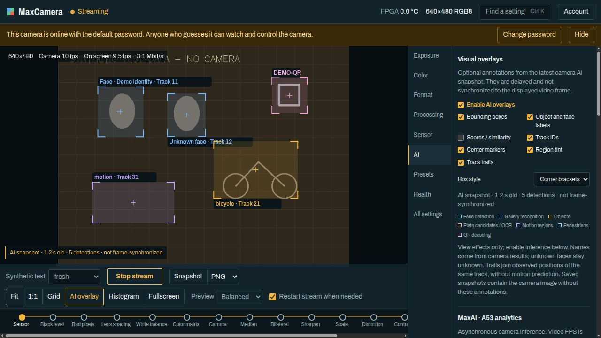
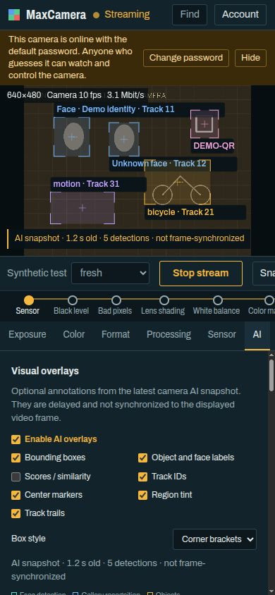

# MaxCameraApp

## Руководство пользователя и администратора

**MaxCamera Control • Русская редакция • 6 ноября 2026**

Просмотр GigE Vision-камеры в браузере, управление изображением, экспериментальная аналитика MaxAI и визуальные аннотации.

Для оператора: начните с раздела 1. Для AI: разделы 11-15. Для установки и сопровождения: разделы 17-22.

**Совместимость:** приложение ориентировано на DinxTech MaxCamera MAX 5640, сенсор OV5640 и плату ALINX AXU2CGB. Карта функций закреплена за прошивкой `0.3.16-ai-linux-dev`. Другую камеру или прошивку нельзя считать совместимой только потому, что она поддерживает GigE Vision.

**Перед первым использованием**

- Замените начальный пароль `admin` / `admin` до предоставления доступа другим людям или из интернета.
- Камера, поток и настройки общие для всех вошедших пользователей. Остановка потока и Reset camera затрагивают других операторов.
- AI экспериментален. Результат может быть неверным или запаздывать; отметка FRESH не означает совпадения с текущим видеокадром.
- Сначала работайте локально. Публикация в интернет и изменение сетевых настроек требуют отдельной подготовки.

Названия кнопок и полей оставлены на английском, как в интерфейсе. Команды ниже выполняются из каталога проекта, если явно не указано иное. Фактические доступность, пределы и шаг изменения функций зависят от текущего состояния камеры и ее XML-карты.

<!-- pagebreak -->

# Содержание

<!-- toc -->
- [1. Быстрый старт и вход](#1-быстрый-старт-и-вход)
- [2. Экран и навигация](#2-экран-и-навигация)
- [3. Поток, качество и статистика](#3-поток-качество-и-статистика)
- [4. Просмотр, масштаб и снимки](#4-просмотр-масштаб-и-снимки)
- [5. Как изменять настройки](#5-как-изменять-настройки)
- [6. Exposure и Color](#6-exposure-и-color)
- [7. Format: режим, ROI и сеть](#7-format-режим-roi-и-сеть)
- [8. Processing: FPGA-конвейер](#8-processing-fpga-конвейер)
- [9. Sensor: тесты и эффекты](#9-sensor-тесты-и-эффекты)
- [10. Health и All settings](#10-health-и-all-settings)
- [11. MaxAI: подготовка и запуск](#11-maxai-подготовка-и-запуск)
- [12. AI-группы: лица, объекты, номера](#12-ai-группы-лица-объекты-номера)
- [13. AI-группы: движение, QR, треки](#13-ai-группы-движение-qr-треки)
- [14. AI: параметры, состояния и результаты](#14-ai-параметры-состояния-и-результаты)
- [15. AI overlay: что видно на видео](#15-ai-overlay-что-видно-на-видео)
- [16. Presets и совместное использование](#16-presets-и-совместное-использование)
- [17. Установка и локальный preview](#17-установка-и-локальный-preview)
- [18. Службы и учетная запись](#18-службы-и-учетная-запись)
- [19. Безопасность и удаленный доступ](#19-безопасность-и-удаленный-доступ)
- [20. Неполадки: вход, видео и настройки](#20-неполадки-вход-видео-и-настройки)
- [21. Неполадки MaxAI и границы системы](#21-неполадки-maxai-и-границы-системы)
- [22. Разработчику: проверка и обновление](#22-разработчику-проверка-и-обновление)
- [23. Файлы, источники и сборка PDF](#23-файлы-источники-и-сборка-pdf)
<!-- /toc -->

<!-- pagebreak -->

# 1. Быстрый старт и вход

## Что должно быть готово

Нужны камера с подходящей прошивкой, питание и Ethernet-соединение с Linux-компьютером, настроенный адрес и MAC камеры, работающие компоненты приложения и браузер с JavaScript и cookies. Интернет не нужен для обычного локального просмотра. Прошивка и AI-модели в приложение не входят.

Для уже установленной службы откройте `http://localhost:8080/` на компьютере приложения. Для временного локального preview адрес другой: `http://localhost:8081/`. `localhost` на телефоне означает сам телефон: для другого устройства нужен разрешенный сетевой адрес сервера. Само открытие страницы не делает сервер доступным в локальной сети.

## Первый сеанс

1. Введите Username и Password, нажмите **Sign in**. При новом файле состояния начальные данные: `admin` и `admin`.
2. Откройте **Account**, введите Current password и New password, нажмите **Change password**. Новый пароль должен содержать не менее 8 символов. Остальные session tokens станут недействительными; уже открытые видеосоединения могут сохраняться до разрыва (раздел 18).
3. Убедитесь, что другая программа не управляет камерой. Нажмите **Start stream**.
4. Для известной цветной конфигурации выберите **Format → Full-field color preview**. Это изменяет настройки камеры, а не только вид страницы.
5. Дождитесь первого кадра. Проверьте разрешение, Camera fps, On screen fps и предупреждения partial/dropped.
6. По окончании нажмите **Stop stream**, чтобы освободить камеру. **Sign out** находится в Account и сначала останавливает общий поток.

Если камера занята, приложение предлагает ожидание и повторяет попытку через 5 секунд. **Cancel waiting** прекращает ожидание. Не закрывайте чужую программу без согласования с ее оператором.

## Браузеры и мобильный экран

Проверки интерфейса выполнялись в встроенной Chromium-панели при настольном и узком мобильном размере. Работа в Chrome, Edge, Firefox, Safari и на физических мобильных устройствах не подтверждена отдельными проверками. Плагины браузера не требуются. При узком окне изображение остается сверху, панель настроек прокручивается ниже.

<!-- pagebreak -->

# 2. Экран и навигация

## Основные области

- **Top bar:** состояние камеры, текущие показания/формат, **Find a setting** и **Account**.
- **Viewport:** изображение, статистика потока, сетка, гистограмма и необязательные AI-аннотации.
- **Transport bar:** Start/Stop, Snapshot, Fit, 1:1, Grid, AI overlay, Histogram, Fullscreen, Preview и Restart stream when needed.
- **Processing chain:** стадии обработки от сенсора до выхода. Нажатие на стадию открывает соответствующий раздел.
- **Settings panel:** Exposure, Color, Format, Processing, Sensor, AI, Presets, Health и All settings.

Заполненная янтарная точка в Processing chain означает включенную стадию, пустая - обход. Стадии FPGA затемнены, если главный FPGA pipeline выключен. Индикатор показывает настройку стадии, а не доказательство ее качества для конкретной сцены.

## Состояния камеры

| Надпись | Что означает |
|---|---|
| Camera free | Камера свободна для управления. |
| Streaming | Приложение получает поток. |
| Applying settings | Управление удерживается для изменения параметров. |
| In use by another application | Контроллером является другая программа. |
| Camera offline | Камера не отвечает. Проверьте питание, сеть и адрес. |
| Camera idle / Checking camera | Состояние еще уточняется или недоступно. |

## Поиск и клавиатура

**Find a setting**, Ctrl+K или Cmd+K открывают поиск. Введите часть английского имени, например Exposure, gamma или packet delay. Результат переводит к соответствующему полю. В **All settings** имеется отдельный **Filter settings**.

Когда фокус не находится в поле ввода: **Space** запускает/останавливает поток, **S** сохраняет Snapshot, **F** включает/выключает полноэкранный режим. Поиск Ctrl+K/Cmd+K работает и из поля ввода.

Описание камеры можно прочитать в подсказке поля на настольном экране и в развернутой категории All settings. Ошибки и подтверждения появляются в уведомлениях и диалогах; читайте их до повторения команды.

<!-- pagebreak -->

## Экран: настольный и узкий вид





Синтетическая демонстрация интерфейса: сцена, имена, детекции и AI-результаты созданы тестовым стендом. Это не съемка реальной камеры и не оценка точности моделей. Баннер стандартного пароля относится к одноразовому тестовому стенду. Видимый элемент Synthetic test относится только к fixture и отсутствует в production.

<!-- pagebreak -->

# 3. Поток, качество и статистика

**Start stream** использует текущую конфигурацию. **Stop stream** останавливает захват, очищает назначение видеопотока и освобождает управление. Это один общий поток приложения, а не отдельная камера на вкладку браузера.

## Preview не меняет режим камеры

| Режим | Ширина preview, максимум | JPEG quality | Предел preview fps |
|---|---|---|---|
| Minimal | 320 px | 40 | 10 |
| Data saver | 640 px | 50 | 30 |
| Balanced | 1280 px | 75 | 30 |
| Full detail | Без уменьшения ширины | 90 | 30 |

Изображение не увеличивается до выбранного максимума. Эти значения ограничивают кодирование preview на сервере и не гарантируют частоту камеры, сети или браузера. На медленном подключении приложение может автоматически начать с Minimal. Для камерного JPEG кадр без уменьшения может передаваться без повторного кодирования; выбор quality тогда не переупаковывает его.

Доставка ограничивает число ожидающих кадров и пропускает кадры, которые клиент не успевает принять. Это сдерживает накопление очереди, но не устраняет задержку сети и декодирования. Настройка Preview общая на сервере и может влиять на других зрителей.

## Как читать показатели

- **Camera:** частота кадров, полученных приложением. Это не обещанная частота сенсора.
- **On screen:** приблизительная частота вывода в этом браузере по окну последних двух секунд.
- **Mbit/s:** объем JPEG-preview в этом браузере; это не полная нагрузка GigE между камерой и сервером.
- **partial:** неполные кадры, где недостающие участки заполнены данными предыдущего кадра. Такие участки могут быть устаревшими.
- **dropped:** отброшенные кадры из-за слишком больших потерь. **No frames from the camera** означает отсутствие свежих кадров.

## Автоматическое освобождение

При отсутствии подключенных зрителей web-шлюз останавливает поток после 15 секунд. Скрытая вкладка сразу отключает доставку видео в нее и через 60 секунд отправляет общую команду остановки. Поэтому фоновая вкладка способна остановить поток и для других зрителей. При потере связи перепроверьте состояние после восстановления; не считайте старое изображение подтверждением работающей камеры.

<!-- pagebreak -->

# 4. Просмотр, масштаб и снимки

## Масштаб в браузере

- **Fit:** вписывает весь выходной кадр в область просмотра.
- **1:1:** масштаб 1 относительно пикселей исходного выхода камеры и CSS-пикселей страницы. Это не гарантия физического соответствия пикселям экрана при системном масштабировании.
- Колесо мыши меняет масштаб относительно курсора. На сенсорном экране используйте жест двумя пальцами. Перетаскивание перемещает изображение, двойное нажатие возвращает Fit.
- Допустимый масштаб вида ограничен диапазоном 0,05-16. При большом увеличении изображение становится пиксельным.
- **Fullscreen** разворачивает область изображения, если браузер разрешает этот режим.

При уменьшенном Preview кнопка 1:1 не возвращает утраченные детали: preview все еще содержит меньше пикселей, чем исходный кадр. Для проверки фокуса выберите Full detail или сделайте полноразмерный снимок.

**Grid** показывает сетку третей. **Histogram** строится по уменьшенной копии показанного preview и отражает распределение R/G/B для просмотра. Она не заменяет измерение исходного RAW и не является калиброванным прибором.

## Snapshot

1. Запустите поток и дождитесь кадра.
2. Выберите PNG или JPEG рядом с **Snapshot**.
3. Нажмите Snapshot или S. Файл загружается средствами браузера; место сохранения зависит от его настроек.

Сохраняется последний доступный кадр с полным разрешением выхода камеры, без уменьшения Preview. Это не команда отдельной экспозиции и не гарантия кадра ровно в момент нажатия. При исходном камерном JPEG сохраняется исходный JPEG даже при выбранном PNG. Для остальных форматов выполняется преобразование в цветное изображение и кодирование PNG либо JPEG (quality 95).

Снимки не содержат браузерных Grid, Histogram, AI overlay, увеличения или панорамирования. Но сенсорный Overlay rectangle и другие изменения камеры уже входят в изображение. PNG не превращает преобразованный Bayer/10-bit-кадр в необработанный RAW: исходный RAW-файл эта функция не экспортирует.

**Не путайте два увеличения.** Просмотр колесом/Fit/1:1 меняет только страницу. **Format → Twofold digital zoom** меняет ROI и FPGA scaler камеры, а значит влияет на поток, снимки и других пользователей.

<!-- pagebreak -->

# 5. Как изменять настройки

Обычные поля применяются при перемещении регулятора или подтверждении числового значения. После записи приложение перечитывает камеру: ориентируйтесь на принятое значение, а не только на введенное. Целочисленные поля имеют шаг, а пределы могут меняться вместе с форматом и режимом.

## Когда требуется остановка

Отметка перезапуска у поля означает, что параметр нельзя менять во время захвата. При включенном **Restart stream when needed** приложение приостанавливает поток, записывает значения и возобновляет его. Длительность зависит от операции: таблица gamma и комплексные quick setups требуют больше записей, чем одиночное поле.

Если опция выключена, требующие остановки поля недоступны до Stop stream. Перезапуск не исправляет блокировку автоматическим режимом, неподходящую конфигурацию или занятость другой программой.

## Почему поле недоступно

- **Controlled by auto exposure** или аналогичная подсказка: отключите соответствующий автоматический режим, если хотите ручное управление.
- **Not available in this setup:** функция не поддерживается выбранным маршрутом/форматом либо выключен ее родительский блок.
- **Locked:** камера или операция временно блокирует запись.
- **Start the stream to change AI:** параметры MaxAI меняются только в активном потоке, которым владеет приложение.
- Некоторые функции по политике безопасности скрыты или доступны только для чтения независимо от исходного XML.

## Особые операции

Матрица, gamma, эффекты сенсора и сенсорный прямоугольник имеют свои **Apply**-кнопки. Изменение полей такого редактора само по себе не означает запись всей группы. Для **Reset to identity** отдельно требуется Apply matrix.

Quick setups заменяют несколько параметров в определенном порядке. Если запись группы прервалась с ошибкой, не предполагайте откат: перечитайте значения и примените известную конфигурацию заново, согласовав это с оператором камеры.

Большинство настроек временные до перезапуска камеры. Для поддерживаемых сохраняемых параметров используйте UserSet в Presets. AI-настройки и выбор AI-функций в UserSet не сохраняются. Browser view/AI overlay также не становятся камерным пресетом.

<!-- pagebreak -->

# 6. Exposure и Color

## Exposure

- **Auto exposure** управляет экспозицией; для ручного **Exposure time** сначала выберите Off. Exposure time задается в микросекундах, а не миллисекундах.
- **Auto exposure target** - целевая яркость автоматики, 8-240. **Exposure limit, 50 Hz lighting / 60 Hz lighting** ограничивают автоматическую экспозицию в строках сенсора.
- **Auto gain** включает автоматическое усиление. Ручной **Gain** представляет линейный коэффициент 1-63,9375×; Auto gain limit ограничивает автоматику тем же диапазоном.
- **Night mode** позволяет сенсору увеличивать экспозицию при недостатке света. Это может уменьшить частоту кадров и смазать движение.
- **Limit frame rate** включает ограничение **Frame rate limit**. Показание **Sensor frame rate** относится к сенсору; доставленная частота может быть ниже.
- **Light flicker filter** связан с освещением 50/60 Hz. Проверяйте результат под реальным светом; это не универсальное устранение мерцания.

Для ручной настройки сначала отключите автоматику соответствующего параметра, начните с умеренной экспозиции/усиления и меняйте по одному полю. Длинная экспозиция и усиление решают разные задачи и могут ухудшать передачу движения или видимый шум.

## Color: два разных white balance

**White balance on the sensor** работает при выключенной FPGA processing. **White balance in the FPGA** относится к RAW-маршруту с включенной FPGA. Ручные RGB gains и автоматический режим у них разные. Sensor gains: 1/1024-4095/1024×; ручные FPGA gains: 0-16×. Пределы Exposure time вычисляются по режиму сенсора и не имеют одного универсального диапазона.

**На FPGA/RAW-маршруте держите Sensor auto white balance в Off.** В этом проекте его оцениватель способен уйти к нулевым gain и сделать кадр черным. Full-field color preview настраивает нужное сочетание. При выключенной FPGA проверьте сенсорный баланс отдельно.

## Color matrix и Gamma curve

**Color matrix** содержит 3×3 коэффициента и три offsets. Строки задают выходные R/G/B. Поля ограничены от -8 до 7,999. **Read from camera** считывает матрицу; **Reset to identity** заполняет нейтральные значения локально; **Apply matrix** записывает их. Единичная матрица не является калибровкой камеры/объектива.

В **Gamma curve** выберите gamma от 0,2 до 4 и нажмите **Apply curve**. Записываются 256 значений для каждого из трех каналов; операция занимает время и включает Gamma curve. Значение 1,8 используется quick setup, но не является универсальной цветовой калибровкой.

<!-- pagebreak -->

# 7. Format: режим, ROI и сеть

## Start from a known setup

| Quick setup | Конфигурация выхода |
|---|---|
| Camera test bars | 640×480, YUV422_8, тестовые цветные полосы сенсора; sensor AWB выключен. |
| Full-field color preview | Весь сенсор 2592×1944 через scaler в 640×480 RGB8; FPGA, gamma 1,8, FPGA AWB. |
| Twofold digital zoom | Центральный ROI 640×480 с началом (976, 732), увеличенный до 1280×960 RGB8. |
| Native sensor video | 640×480 YUV422_8, процессор сенсора, FPGA выключена. |
| Maximum resolution | 2592×1944 YUV422_8, FPGA выключена. |

Частота, цвет и стабильность зависят от железа, прошивки, света, сети и настроек. Числа fps в подсказках quick setups - ориентиры разработки, не гарантированные показатели.

## Output image и Compression

**Pixel format**, Width/Height, Offset X/Y задают выходной формат и геометрию. **Mirror** и **Flip** меняют ориентацию. **PayloadSize** - объем полезных данных кадра.

**Compression = JPEG** требует 640×480, YUV422_8 и выключенную FPGA processing. Пока JPEG включен, геометрия заблокирована. **JPEG quantization (lower is better)** - камерная настройка квантования, не тот же параметр, что качество Preview. Камерный JPEG-маршрут не квалифицирован испытаниями этого приложения.

Конвертер preview поддерживает Mono8, BayerBG8/10/10p, RGB8/BGR8, RGB565 и ряд упакованных RGB/YUV форматов этой XML-карты. Неизвестный PFNC вызывает ошибку preview. Наличие пункта в прошивке не означает поддержку любой сторонней упаковки. Для AI нужен прямой FPGA RGB8/BGR8 без compression.

## FPGA scaler and crop

Input width/height задают исходную геометрию, Crop region (ROI), ROI X/Y/width/height - вырезаемую область, Width/Height - выход. **Interpolation** выбирает алгоритм масштабирования. Input width: 16-2592, шаг 16; input height: 8-1944, шаг 2. ROI должен целиком помещаться в input. Area допускает уменьшение; Polyphase - увеличение до 4× по оси, но не все формально разрешенные режимы квалифицированы. При выключенном scaler малый выход может быть узким обрезанным участком, а не уменьшенным полным полем зрения.

**Packet delay (µs)** разносит сетевые пакеты. При нуле приложение само выбирает pacing на время потока и восстанавливает ноль при освобождении. Диапазон delay - 0-1000000 µs. Увеличение delay может уменьшать потери, но снижает пропускную способность; не меняйте системные сетевые лимиты вслепую.

<!-- pagebreak -->

# 8. Processing: FPGA-конвейер

**FPGA pipeline / FPGA processing** - главный переключатель RAW-конвейера. При Off используется процессор изображения сенсора. Отдельные FPGA-эффекты при этом не следует ожидать на выходе.

| Группа | Назначение и ограничения |
|---|---|
| Black level | Вычитание черного уровня 0-1023. Завышение удаляет детали в тенях. Black level live active показывает текущее применение. |
| Bad pixels | Коррекция выбросов по соседним отсчетам. Не заменяет проверку дефектов сенсора. |
| Lens shading | Коррекция неравномерности освещения. Нужна flat-field-калибровка для реальной оптики; gains доступны в All settings. |
| Median filter | Подавление отдельных выбросов; может стирать тонкие детали. |
| Bilateral filter | Сглаживание с учетом границ. Range sigma и Spatial sigma регулируют эффект; сильные значения убирают текстуру. |
| Sharpening | При 0 выключена. Сильное усиление может создавать ореолы и подчеркивать шум. |
| Distortion correction | Требует подходящей карты для объектива. Карта загружается отдельным desktop-инструментом проекта; проверьте Map state. |
| Local contrast | CLAHE и Clip limit. Выходная ширина должна быть кратна 8, высота - 4. |
| Adaptive tone | Адаптивная тональная кривая с Tone target и показаниями примененного gain/предыдущего среднего. Это не HDR. |
| Focus and motion | Анализ сцены: Focus score, Motion score/valid, Mean brightness, Clipped pixels, Dark pixels. Показания полезны для сравнения при ручном фокусировании. |

White balance, Color matrix и Gamma редактируются в Color, а scaler/ROI - в Format. Processing chain дает прямые переходы к этим группам и показывает порядок стадий.

Первый кадр после запуска может обходить стадии, которым нужен предыдущий кадр. Не оценивайте окончательный результат по одному первому кадру. Focus score - внутренний показатель сцены, а не универсальная единица резкости; сравнивайте при неизменных сцене, свете и масштабе.

FPGA Motion score из этого раздела и **AI → Motion regions** - разные функции. Первое дает метрику FPGA, второе - области по выборочным кадрам AI-воркера.

<!-- pagebreak -->

# 9. Sensor: тесты и эффекты

## Test pattern

**Test pattern** и дополнительные Sensor test pattern style, rolling, transparent и monochrome нужны для диагностики тракта. Сначала выключите Sensor auto white balance в Color, иначе тестовый рисунок может стать черным. Для базового теста используйте **Format → Camera test bars**.

Нормальные полосы помогают отделить проблему сцены/оптики от проблемы доставки или преобразования кадра. Но они не подтверждают работу реальной экспозиции, оптики, AI или точность цветов в рабочем режиме. После теста верните Test pattern в Off либо примените рабочий quick setup.

## Sensor image processor

**Auto sharpness / Sensor sharpness** и **Auto denoise / Sensor denoise** относятся к процессору сенсора. Они не действуют на RAW-выход. Не путайте их с Median/Bilateral/Sharpening FPGA.

При ручной оценке отключайте соответствующий auto-режим и проверяйте результат на постоянной сцене. Одновременная сильная обработка нескольких стадий затрудняет поиск причины дефекта.

## Effects

Группа содержит **Effect enable bits**, brightness, contrast, hue cosine/sine, U/V, Y offset, signs, manual saturation и UV thresholds. Это низкоуровневые параметры камеры, а не набор готовых художественных фильтров.

1. Остановите поток либо разрешите Restart stream when needed.
2. Запишите согласованные значения и маску нужных эффектов.
3. Нажмите **Effect Apply**.
4. Проверьте принятые значения и изображение; при ошибке вернитесь к известному setup.

Не интерпретируйте отдельный hue cosine/sine как обычный угол в градусах. Единицы и пределы каждого параметра смотрите в описании камеры в All settings.

## Overlay rectangle

**Overlay enable**, Left/Right/Top/Bottom и U/V задают прямоугольник в сенсорном изображении. После настройки выполните **Overlay Apply**. Это камерный эффект, который может попасть в Snapshot и поток другой программы.

**Overlay rectangle не связан с AI overlay.** Последний рисуется только браузером по задержанным AI-результатам, имеет собственные переключатели и в Snapshot не сохраняется.

<!-- pagebreak -->

# 10. Health и All settings

## Health

**Device** показывает производителя/модель, серийный номер, версии firmware/device/FPGA, device name, текущий адрес и uptime. Эти показания помогают проверить нужную камеру. Не публикуйте снимки панели с частными идентификаторами и адресами без необходимости.

**Temperature and fan:** FPGA temperature - температура кристалла FPGA, не температура сенсора изображения. Fan start temperature, Fan stop temperature и Fan speed задают управление вентилятором. Диапазоны порогов от -40 до 125 °C, Start должен быть выше Stop; duty cycle 0-100%. Датчика фактической скорости вращения нет: заданный duty cycle не подтверждает физическое вращение.

Группы диагностики:

- **Frames:** Captured frames, Transmitted frames, Dropped frames, CSI error events и Camera recovery count.
- **Network:** Ethernet link, принятые/переданные пакеты, ошибки и drops, stream send retries и counters resend.
- **Sensor:** initialized/state/busy, last error, transport error и средняя яркость.

Значения обновляются примерно каждые 1,5 секунды во время потока. При остановленном потоке **Read values now** выполняет разовое чтение. Появление счетчика resend в карте функций не означает, что приложение использует повторную передачу пакетов: в текущем receiver packet resend не задействован.

Смотрите изменение счетчиков во времени, а не только ненулевое значение. После сброса устройства счетчики и uptime могут обнулиться. Не делайте аппаратный вывод по одному снимку панели.

## All settings

Полный доступный приложению набор GenApi-функций сгруппирован по категориям. **Filter settings** ищет по внутреннему и отображаемому имени. Раскройте категорию, чтобы увидеть поля и описания.

Здесь находятся расширенные lens-shading gains, браузер сенсорных регистров, OTP и voice-coil controls. Это инструменты для подготовленного пользователя; сохраняйте исходные значения и изучайте описание перед записью.

Для индексированных таблиц сначала выбирают selector/index/channel, затем читают или записывают соответствующее value. Изменение selector не записывает сразу всю таблицу. Безопасностная политика скрывает сетевые/служебные функции и блокирует часть записей на стороне bridge; All settings не обходит эти ограничения.

<!-- pagebreak -->

# 11. MaxAI: подготовка и запуск

MaxAI - экспериментальный блок камеры. R5 сохраняет управление камерой и GigE-трактом, A53 Linux выполняет асинхронное распознавание. Веб-приложение читает контракт MaxAI; оно не переносит модели в браузер и не обучает их.

## До включения

- Камера должна иметь совместимую прошивку, работающий AI-воркер и отдельно подготовленные модели. Они не поставляются в этом репозитории приложения.
- Для передачи кадров воркеру требуется **FPGA processing = On**, **Pixel format = RGB8 или BGR8**, **Compression = Off** и активный поток приложения.
- **Format → Full-field color preview** задает подходящий маршрут. Другие форматы могут нормально показывать видео, но не давать AI-кадры.
- **Loaded** у конкретной группы означает поддержку, объявленную текущим воркером. **Unavailable** нельзя исправить одним включением браузерной галочки.

## Пошаговый сеанс

1. Запустите поток и откройте AI. Проверьте строку **Frame route** и **Worker**.
2. Начните с одной небольшой группы, например Face detection. Выберите ее флажок.
3. Нажмите **Apply selection**. Простое изменение флажков еще не меняет набор функций камеры.
4. Читайте **Result snapshot**, Worker error и Last inference latency. Во время видимого AI-раздела и потока приложение запрашивает результаты примерно раз в 2 секунды.
5. Для остановки только аналитики нажмите **Disable AI**: видео продолжит работать.
6. **Stop stream** освобождает камеру, очищает включение AI и показанный результат. В следующем сеансе выберите/примените набор снова: автоматического повторного включения нет.

**Read AI state** выполняет чтение и без потока, не захватывая управление. Это диагностика доступности, а не запуск inference. Параметры AI недоступны для записи без активного потока приложения.

Набор из всех функций может давать существенно более старые результаты. Частота видео и скорость AI - разные показатели. Для проверки новой функции сначала уменьшайте набор, а не ожидайте один AI-результат на каждый видеокадр.

<!-- pagebreak -->

# 12. AI-группы: лица, объекты, номера

## Face detection

Детектор YuNet возвращает прямоугольники лиц. Обнаруженное лицо еще не является распознанным человеком. На результат влияют масштаб, поворот, закрытие лица, свет и модель. Наличие рамки не подтверждает личность.

## Gallery recognition

Сравнение SFace с частной галереей лиц; при необходимости выполняется детекция лица. Пустая галерея возвращает **unknown**. Протокол не сообщает число записей галереи, поэтому Unavailable/unknown нельзя использовать как счетчик регистрации.

Приложение не загружает и не регистрирует лица и не управляет галереей. Ее подготовка выполняется отдельно средствами проекта камеры. В текущем upstream используются только face presets; папки plate/object presets зарезервированы и не означают обучение соответствующих групп.

Для совпавшего лица score - **cosine similarity**. Для неизвестного лица - score детектора, а не низкая вероятность конкретного человека. Unknown face остается неизвестным и в overlay. Ошибочное совпадение возможно; не используйте результат как единственное основание для решения о доступе или личности.

## Objects

YOLOX обнаруживает объекты 80 классов COCO. Это ограниченный набор классов, а не произвольное распознавание предметов. COCO person и отдельная группа Pedestrians - разные детекторы.

Результат содержит class ID, текстовую метку, score и box. Низкий порог может увеличивать число ложных срабатываний; высокий - пропуски. Ни одно значение не является калиброванной вероятностью правильного ответа.

## Plate candidates / OCR

Возвращает кандидаты областей номера и, когда доступно, текст OCR. Поиск зависит от типа/страны номера и условий съемки. Качество OCR не квалифицировано; рамка не доказывает наличие корректно прочитанного регистрационного знака.

Score этой группы показывается как **marker**, а не статистическая уверенность. Текст ограничен контрактом, как и у QR; сверяйте исходное изображение вручную. Не обещайте поиск автомобилей или обучение по номерным presets: таких функций веб-интерфейс не реализует.

## Приватность

Галереи, лица, номера и scene captures могут содержать персональные данные. Не добавляйте их в публичный Git. Приложение не делает сам результат допустимым для любой цели обработки; соблюдайте правила и согласия, применимые к вашей съемке.

<!-- pagebreak -->

# 13. AI-группы: движение, QR, треки

## Motion regions

Области изменения между выборочно переданными кадрами. Изменение освещения, движение самой камеры и шум также могут вызывать срабатывания. Это не классификация действий человека и не охранная гарантия.

Score является операционным **marker**. Не путайте Motion regions с FPGA Motion score в Processing: они вычисляются разными трактами и имеют разный смысл.

## Pedestrians

Отдельный HOG/SVM-детектор пешеходов. Он не тождественен классу person у Objects. Различие рамок и пропуски между двумя группами не обязательно означают сбой приложения.

Выбирайте группу по своей задаче и сравнивайте на реальных условиях. Приложение не подтверждает точность подсчета людей, безопасность прохода или качество работы на любом расстоянии.

## QR decoding

Возвращает область и распознанный текст QR, если декодирование удалось. Текст ограничен **31 байтом UTF-8**, не 31 символом: кириллица и другие многобайтные символы сокращают доступную длину. Длинный адрес может оказаться обрезанным.

Score - marker. Метки выводятся как буквальный текст, включая похожие на HTML строки; приложение не исполняет их как разметку. Не открывайте незнакомую ссылку только потому, что она пришла из QR.

## Tracking

Связывает наблюдения детекторов с track ID. Нельзя применить только Tracking без другого детектора: выбор одной этой группы отклоняется. Наличие бита Tracking не означает отдельную классификацию объектов.

Трек истекает после трех выборочных кадров upstream, а не трех кадров браузерного видео. При потере/повторном обнаружении, смене конфигурации и перезапуске ID нельзя считать устойчивой личностью. Один человек или предмет может получить другой ID; один номер трека не служит глобальным идентификатором.

**Track trails** - отдельный браузерный эффект, который соединяет уже полученные позиции одного feature/class/track ID. Он не предсказывает движение и не превращает медленный AI в слежение на частоте видео.

## Как комбинировать

Начните с детектора, затем добавьте Tracking при необходимости. Для нескольких групп контролируйте capture age и Last inference latency. Выбор Sampling interval короче длительности inference не создаст параллельные воркеры и не гарантирует более частые результаты.

<!-- pagebreak -->

# 14. AI: параметры, состояния и результаты

## Inference settings

| Поле | Единицы и смысл |
|---|---|
| Sampling interval (µs) | Интервал допуска новых кадров. Это не период готовых результатов. Занятый единственный воркер пропускает предложения. |
| Minimum model score (millionths) | Порог model score в миллионных долях: 500000 = 0,5. Не придавайте ему смысл вероятности. |
| Face cosine threshold (millionths) | Порог сравнения лиц: 450000 = 0,45 cosine similarity. |

XML задает Sampling interval 100000-60000000 µs (0,1-60 с), Minimum model score и Face cosine threshold 1-1000000; шаг всех трех - 1. Допустимость текущей записи смотрите в полях камеры. Настройки volatile и исключены из UserSet. Запись уже установленного значения не должна менять поколение конфигурации и делать выполняемый результат недействительным.

## Worker и статус снимка - не одно и то же

**Worker:** Unavailable, Idle, Ready, Copying. **Worker error:** 0 None, 1 Worker exception, 2 Rejected result, 3 Cancelled / stale configuration. Проверяйте также Supported / enabled masks, Configuration generation и Last inference latency. Восемь групп соответствуют битам 0-7 маски 0-255; обычно удобнее использовать флажки.

**FRESH** - валидный снимок в пределах 15 секунд от захвата, включая время inference. **STALE** - превышен возраст, не совпали источник/конфигурация либо потеряна подтвержденная живая связь. **WAITING** - подходящий результат еще не появился; **UNAVAILABLE**, **DISABLED**, **ERROR**, **STOPPED** отличают отсутствие воркера, выключенный AI, ошибку и остановленный поток. Нулевой результат явно показывает **0 detections**, а не ошибку.

## Result snapshot

Содержит Request / capture sequence, capture age, размер и PFNC источника, Source configuration, device timestamp и до **32 объектов**. У объекта: feature, class ID, score, text, track ID и box x/y/width/height. Координаты относятся к выходу захваченного кадра **после ROI и scaler**. Сам вход inference ограничен 640 px по длинной стороне; это не уменьшает систему координат возвращаемых boxes до preview.

Request/capture sequence - не GVSP BlockID. Device timestamp - часы устройства, не календарное время. **same result** означает повторное чтение того же запроса, а не новый inference. Возраст увеличивается в браузере между чтениями; приложение консервативно учитывает и HTTP round trip.

Score совпавшего лица - cosine similarity; unknown face - detector score. Plate, Motion и QR используют marker. Остальные model scores тоже не являются калиброванной вероятностью.

<!-- pagebreak -->

# 15. AI overlay: что видно на видео

Откройте **AI → Visual overlays**. Включите **Enable AI overlays**, затем выберите эффекты. Кнопка **AI overlay** на панели транспорта включает/выключает весь слой. Для реальных результатов отдельно требуется запущенный и включенный MaxAI.

| Контрол | Действие |
|---|---|
| Bounding boxes | Рамки объектов. Box style: Corner brackets или Rectangle. |
| Object and face labels | Метки результата; неизвестные лица остаются Unknown face. |
| Scores / similarity | Model score, cosine similarity либо marker согласно типу объекта. |
| Track IDs | Номер трека, когда он присутствует. Это не имя личности. |
| Center markers | Маркер центра прямоугольника. |
| Region tint | Полупрозрачная заливка области. |
| Track trails | Линии между наблюденными позициями текущего трека. |

Цвета различают группы детекторов; легенда находится рядом с настройками. Метки по возможности раздвигаются, но при плотной сцене все еще могут перекрываться. Длинный текст может сокращаться в видимой подписи.

## Ограничение: not frame-synchronized

Бейдж всегда показывает **AI snapshot**, возраст, число detections и **not frame-synchronized**. Даже FRESH относится к захваченному ранее кадру. Для быстрого объекта рамка может оказаться на его прошлом месте. Контракт не дает сопоставления inference с конкретным GVSP-кадром текущего preview.

Слой использует геометрию исходного AI-кадра и общий с видео transform: Fit, 1:1, zoom, pan и уменьшение Preview сохраняют систему координат. Это геометрическое согласование, а не временная синхронизация.

Аннотации скрываются при Stop, смене настроек/конфигурации, потере живой связи, неподдерживаемом маршруте, ошибке/недоступности, несовпадении размера или PFNC и возрасте более 15 секунд. Нулевой успешный результат показывает 0 detections. При остановке также скрывается бейдж.

Track trails хранят максимум 12 наблюдений для текущего feature/class/track ID в том же 15-секундном окне. Повторный опрос того же результата не добавляет точку. Пропавшие треки и старый контекст удаляются; интерполяции и прогноза нет.

Настройки слоя живут в текущем сеансе страницы, не записываются в камеру, пресеты и Snapshot. При включенном слое опрос AI продолжается и на других вкладках настроек, пока страница видима и поток работает.

<!-- pagebreak -->

# 16. Presets и совместное использование

## Сохранение конфигурации

Камера поддерживает семь пользовательских слотов flash: **UserSet1-UserSet7**. **Default** защищен от записи; ручная загрузка Default также заблокирована для обычного web account. Выбор Default как конфигурации power-up - отдельная операция. Панель показывает Saved slots либо No slots saved yet.

1. Настройте изображение и убедитесь, что выбрана нужная камера.
2. В **Presets → Preset slot** выберите пользовательский слот.
3. **Save to preset** перезаписывает этот слот в flash. Прочитайте подтверждение и продолжите только если потеря старого содержимого допустима.
4. **Load preset** применяет доступный сохраненный UserSet сейчас и заменяет несохраненные настройки. Загрузка требует валидного слота и доступного хранилища; пустой или занятый слот может быть недоступен. Перед загрузкой согласуйте остановку/изменение с другими пользователями.
5. **Load at power-up** выбирает пресет старта камеры и запрашивает подтверждение.

AI enablement и inference settings не входят в UserSet. Browser overlays и Preview/view settings не являются камерным пресетом. Сохранение конфигурации в камере не заменяет документацию значений и резервирование проекта.

**Reset camera** возвращает конфигурацию старта, разрывает соединения и может затронуть другие приложения. Кнопка запрашивает подтверждение. Не используйте Reset как первое средство от медленной сети или неизвестного AI-результата.

## Один контроллер и общие изменения

GigE Vision допускает одного контроллера. Приложение не вытесняет чужой контроллер. Оно берет управление для потока либо записи параметров; после одиночных изменений освобождает его примерно через 1,5 секунды. Пока никто не вошел, оно не обращается к камере; при открытой странице без потока выполняется редкое чтение статуса примерно раз в 10 секунд.

Все подписанные пользователи приложения используют одну камеру, поток и конфигурацию. Нажатие Stop, изменение Preview, quick setup или Presets может повлиять на других. Отдельных ролей «только просмотр» и независимых сеансов камеры нет.

При Stop приложение останавливает acquisition, ждет idle, снимает transport locks, очищает stream destination/port, восстанавливает pacing и отпускает управление. При аварии освобождение зависит от настроенного firmware heartbeat timeout, а не от закрытия одной страницы мгновенно.

Перед eBUS Player остановите поток здесь. Перед Start stream закройте контролирующее соединение eBUS Player. Измененная здесь геометрия останется общей и будет видна следующей программе.

<!-- pagebreak -->

# 17. Установка и локальный preview

## Требования хоста

Текущий seccomp-фильтр написан **только для Linux x86-64**. Runtime использует системный `/usr/bin/python3` версии 3.10 или новее; активный venv/Conda сам по себе не меняет интерпретатор sandbox. Нужны bubblewrap (`bwrap`), разрешенные unprivileged user namespaces, GCC, gzip и shell-утилиты. systemd user services нужны для установленного режима, но не временного preview. Node.js требуется только для JavaScript-проверок разработчика.

Из корня опубликованного проекта выполните:

```bash
./deploy/bootstrap-local.sh
```

Bootstrap устанавливает закрепленные зависимости в `pydeps/`, собирает receiver `backend/libgvsp_rx.so` и создает `deploy/maxcamera.env` из `deploy/maxcamera.env.example`, только если env еще отсутствует. Он не запускает камеру и не открывает порты. Установка системных пакетов и namespaces остается задачей администратора.

`requirements.txt` задает aiohttp 3.14.5, numpy 2.2.6 и opencv-python-headless 4.12.0.88; `requirements.lock.txt` фиксирует разрешенные версии прямых и транзитивных зависимостей. Это не комплект wheels с проверкой хешей. Ручная установка использует тот же системный Python:

```bash
/usr/bin/python3 -m pip install --target pydeps -r requirements.txt
```

Не смешивайте wheels другой архитектуры или Python. Прошивка, AI-модели, cloudflared и локальные runtime-каталоги не входят в обычную исходную поставку. Повторный bootstrap не заменяет уже существующий env. Чистая установка на новом хосте требует собственной проверки: состав зависимостей не гарантирует совместимость его kernel/namespaces и сетевого окружения.

## Конфигурация камеры

`deploy/maxcamera.env` задает `MAXCAMERA_IP`, `MAXCAMERA_MAC`, `MAXCAMERA_LISTEN`. Не подставляйте адреса из чужого примера. Команда ниже выполняет ограниченное read-only discovery и принимает только настроенный MAC:

```bash
python3 deploy/discover-camera.py
```

По проверенному результату обновите локальный MAXCAMERA_IP и перезапустите нужные компоненты. Discovery не меняет адрес камеры и не перенаправляет уже открытые sockets bridge. Для другого физического экземпляра сначала проверьте его настоящий MAC.

## Изолированный preview

```bash
./deploy/preview-local.sh
```

Оставьте терминал открытым и посетите `http://localhost:8081/`. Preview запускает те же три sandbox-компонента, но с отдельными IPC, журналами и account state под `run/ai-preview/`. Новое состояние начинается с admin/admin. Ctrl+C завершает только preview, а не установленные службы.

Preview не публикует приложение и не гарантированно живет после закрытия терминала. Для логов смотрите `run/ai-preview/log/`. Не запускайте одновременно захват preview и установленной службы: физический контроллер у камеры один.

<!-- pagebreak -->

# 18. Службы и учетная запись

## systemd user services

Приложение разделено на **bridge**, **web** и **edge**, объединенные target. Готовые unit-файлы лежат в `deploy/systemd/`. Шаблоны опубликованной поставки используют `%h/MaxCameraApp` (то есть `~/MaxCameraApp`). Если проект находится в другом каталоге, исправьте ExecStart и EnvironmentFile перед установкой. Скопируйте адаптированные файлы в `~/.config/systemd/user/`, затем:

```bash
systemctl --user daemon-reload
systemctl --user enable --now maxcamera-control.target \
  maxcamera-control-bridge.service \
  maxcamera-control-web.service \
  maxcamera-control-edge.service
```

Диагностика и управление установленными службами:

```bash
systemctl --user status maxcamera-control-bridge \
  maxcamera-control-web maxcamera-control-edge
journalctl --user -u maxcamera-control-bridge \
  -u maxcamera-control-web -u maxcamera-control-edge -f
systemctl --user restart maxcamera-control-bridge \
  maxcamera-control-web maxcamera-control-edge
```

Restart прерывает активные подключения; выполняйте в согласованное окно. Для остановки замените restart на stop. Для удаления автозапуска используйте `disable --now` для target и трех служб. User services могут завершаться при выходе пользователя, если не настроен lingering. `sudo loginctl enable-linger "$USER"` меняет поведение запуска после выхода и требует осознанного решения администратора.

## Пароль, сеансы и восстановление

У приложения один account, не база независимых пользователей. **Account → Change password** сохраняет salted scrypt hash в локальном auth.json с правами 600 и инвалидирует остальные session tokens. Срок tokens - 12 часов; они не переживают restart web. Уже открытые WebSocket не переавторизуются и не закрываются немедленно при смене пароля или expiry: следующий API-запрос либо новое соединение потребует входа. Для принудительного разрыва всех соединений локально перезапустите web в согласованное окно. **Sign out** останавливает общий поток, закрывает свой token и WebSocket.

После пяти неверных паролей включается возрастающая задержка до 60 секунд; 30 ошибок за минуту временно ограничивают вход для всех. За прокси несколько пользователей могут попадать в один client bucket.

При утраченном пароле остановите относящийся к нему web-компонент, сохраните нужную защищенную резервную копию и удалите **только его** auth-файл: `run/state/auth.json` для службы или `run/ai-preview/state/auth.json` для preview. При следующем запуске появится admin/admin. Закройте внешний доступ до сброса и немедленно смените пароль. Не удаляйте весь run и не публикуйте auth-файл.

<!-- pagebreak -->

# 19. Безопасность и удаленный доступ

## Границы защиты

**edge → Unix socket → web → Unix socket → bridge → камера.** При штатном sandbox-запуске edge принимает TCP на одном порту, web не имеет внешних сетевых интерфейсов, bridge использует заранее открытые UDP-сокеты для настроенной камеры. Проверяется MAC перед получением управления. Bubblewrap, seccomp и NoNewPrivileges ограничивают файловую систему, создание сетевых соединений и запуск программ.

Bridge блокирует запись stream destination/port, IP/subnet/gateway/DHCP, device name, factory password/provisioning, heartbeat, packet size и transport locks. Пользовательский UI не может направить камеру на произвольный хост. Но обладатель пароля все равно может смотреть видео, менять изображение, сохранять presets и сбрасывать камеру. Sandbox снижает риск, но не заменяет обновления Linux/bubblewrap и сетевую защиту.

Cookies имеют HttpOnly и SameSite=Strict; Secure зависит от определения HTTPS запроса/прокси. Применяются CSP и проверка Origin. Настройка reverse proxy и доверия forwarded-заголовкам остается задачей администратора.

## HTTPS tunnel

Сначала смените пароль и оцените допустимость передачи видео провайдеру: он завершает HTTPS и технически может видеть трафик, включая учетные данные и изображение. Бесплатные адреса/лимиты и доступность меняются; это не гарантированный видеоканал.

- `./deploy/public-tunnel.sh` использует системный SSH и localhost.run, пересылая в Unix socket web. Нужны SSH и исходящая сеть; Ctrl+C закрывает этот туннель.
- `./deploy/public-tunnel-cloudflare.sh` загружает официальный Linux amd64 cloudflared в vendor при первом запуске и проксирует **http://127.0.0.1:8080**. Нужен работающий установленный listener 8080; preview на 8081 автоматически не подхватывается. Нужны curl и доступ к источнику/сервису Cloudflare.

Эти tunnel-процессы не входят в три sandbox приложения. Завершение одного туннеля не закрывает другие пути публикации.

## Прямой HTTP наружу

Не используйте открытый HTTP для конфиденциального видео/паролей: трафик можно читать и изменять. `enable-public-ip.sh` меняет firewall, включает lingering и переводит listener на все интерфейсы; `router-forward.py add` меняет UPnP-правило роутера. Это не безопасный «просто запуск».

CGNAT может исключать входящий доступ даже с port forwarding. `router-forward.py check` читает состояние, add/remove меняют его. `disable-public-ip.sh` возвращает loopback и удаляет firewall rule, но правило роутера нужно удалить отдельно. Для рабочей публикации предпочтителен администрируемый HTTPS-прокси/туннель с подходящим контролем доступа и без лишних открытых портов.

<!-- pagebreak -->

# 20. Неполадки: вход, видео и настройки

| Симптом | Проверка и действие |
|---|---|
| Страница не открывается | Уточните 8080 (служба) или 8081 (preview). Для preview проверьте живой терминал/логи. Для службы - status и journalctl. localhost другого устройства не указывает на сервер. |
| Too many attempts | Подождите указанное время, до 60 с; проверьте, нет ли чужих ошибочных входов через общий прокси. Не запускайте перебор. |
| Camera offline | Питание, Ethernet, линк и MAC/IP. Запустите discovery; при изменившемся DHCP-адресе обновите локальный env и перезапустите bridge в согласованное время. |
| Another application is using the camera | Закройте ее контролирующее соединение по согласованию либо ждите. Cancel waiting отменяет автоповтор. |
| The camera service is not running | Проверьте bridge и его log. Не запускайте второй контроллер, пока первый жив. |
| Поток идет без изображения | Дождитесь первого кадра, смотрите No frames/decode error. Stop и известный Format setup помогают проверить конфигурацию, но изменяют общую камеру. |
| Черный FPGA-кадр или test bars | Проверьте Sensor auto white balance: на RAW и test pattern он должен быть Off. Используйте подходящий quick setup. |
| Искаженный цвет native YUV | Проверьте Pixel format и white balance нужного тракта. Сравните Full-field color preview; нейтральность цвета не гарантируется без калибровки. |
| partial/dropped растут | Снизьте разрешение/нагрузку; проверьте Ethernet и Packet delay. Preview снижает браузерный трафик, но не сырой поток камера-сервер. |
| Медленный удаленный preview | Выберите Minimal/Data saver, проверьте туннель и сеть. Full detail требует больше полосы. FPS видео не измеряет скорость AI. |
| Поле серое | Читайте причину. Отключите нужный auto-режим, проверьте родительский FPGA-блок и Restart stream when needed. Не пытайтесь обходить policy через All settings. |
| Snapshot не сохраняется | Нужен кадр работающего потока. Проверьте загрузки/разрешения браузера. Камерный JPEG остается JPEG. |
| Настройка пропала после reset | Временные значения не равны flash preset. Загрузите проверенный UserSet; для AI всегда нужен новый явный запуск. |

При повторяемом сбое запишите версию firmware, режим/размер, краткие действия, точный текст ошибки и релевантный фрагмент журнала. Удалите cookies, пароли, частные адреса, серийные номера и сцены, если они не нужны получателю.

<!-- pagebreak -->

# 21. Неполадки MaxAI и границы системы

## Если AI не показывает ожидаемое

- **Unavailable / группа Unavailable:** сверяйте MaxAIAvailable, Loaded capability mask, версии firmware/моделей и состояние A53 worker. Веб-приложение не устанавливает модели автоматически.
- **Видео есть, AI WAITING:** проверьте FPGA On, RGB8/BGR8, Compression Off, активное владение потоком и ненулевой Apply selection. На YUV/Bayer маршруте AI offers отсутствуют.
- **Tracking requires at least one detector:** добавьте детектор и Apply selection. Один Tracking недопустим.
- **0 detections:** это валидный пустой снимок. Проверьте сцену, размер объекта и порог, но не трактуйте его как гарантию отсутствия объекта.
- **unknown:** проверьте отдельно подготовленную face gallery и threshold. Протокол не сообщает число записей; интерфейс не выполняет enrollment.
- **STALE:** возраст захвата превысил 15 с, результат относится к другой конфигурации/источнику либо нарушена связь. Уменьшите набор функций и дождитесь нового результата. Повторное чтение same result не ускоряет inference.
- **AI overlay пуст, список есть:** включите Enable AI overlays и нужные эффекты. Слой скрывается при несовпадении source/PFNC/generation, изменении настроек и потере live connection. Старую рамку намеренно не удерживают.
- **Рамка отстает:** это ожидаемое следствие not frame-synchronized, а не доказательство неверного масштаба. Сравнивайте возраст и Last inference latency.
- **Worker error:** запишите код и контекст. Cancelled / stale configuration может следовать после изменения режима; при повторяемом Worker exception нужна диагностика прошивки/воркера, не только браузера.

## Известные ограничения

Packet resend в receiver не используется. Неполные кадры могут содержать части прошлого кадра. Большие форматы и потери требуют проверки сети; изменение системных buffer limits - отдельная административная операция.

Режим четырехкратного RGB-увеличения не квалифицирован и может останавливать тракт захвата, хотя диапазон firmware разрешает его выбрать. Distortion map и lens-shading calibration подготавливаются внешними инструментами.

Нет записи видео, экспорта исходного RAW, управления несколькими камерами, отдельной роли viewer, управления/загрузки AI-моделей или галерей в этом UI. Вход дает общий доступ к камере.

AI ограничен 32 объектами и 31 UTF-8 байтом текста на объект. Не подтверждены универсальная точность, качество recognition/OCR, длительная непрерывная работа и сценарий физической MicroSD-загрузки. Нет гарантий fps, задержки, доступности публичной сети и поддержки непроверенных браузеров.

<!-- pagebreak -->

# 22. Разработчику: проверка и обновление

## Закрепленный контракт камеры

`backend/data/upstream.json` фиксирует MaxCamera revision `07dfb588b9576f827968c47c5798d9164561346d`, firmware `0.3.16-ai-linux-dev`, путь XML и его Git blob/SHA-256, а также просмотренные AI contract sources. Прошивка и веса моделей отдельно.

```bash
python3 deploy/update-camera-source.py
python3 deploy/update-camera-source.py --fetch
```

Первая команда проверяет локальную карту. Вторая восстанавливает **тот же закрепленный XML** из upstream после проверки хешей, а не обновляет автоматически до новой версии firmware. Для нового контракта сначала проверьте изменения источников, единиц, state machine и безопасности; не подбирайте регистры догадками.

## Сборка receiver и тесты

После изменения `backend/gvsp_rx.c` пересоберите библиотеку под архитектуру хоста:

```bash
gcc -O2 -std=c11 -Wall -Wextra -Werror -shared -fPIC \
  backend/gvsp_rx.c -o backend/libgvsp_rx.so
PYTHONPATH=pydeps:backend python3 -m unittest discover -s tests -v
node tests/test_ai_ui.cjs
node tests/test_ai_visuals.cjs
PYTHONPATH=pydeps python3 tests/check_http_ai.py
```

Нужен Node.js для JavaScript-тестов. HTTP-проверка требует подходящего приложения; сначала изучите ее адрес/ожидания. `check_http_ai.py --live` дополнительно управляет камерой и выполняет 18-секундный all-feature run со stop/release/transport checks: запускайте только на свободной камере и в согласованное окно. `tests/check_bridge.py` подключайте лишь при остановленном web gateway: bridge IPC рассчитан на одного клиента.

## Проверка overlay без реальной сцены

```bash
PYTHONPATH=pydeps:backend python3 tests/preview_ai_visuals.py
```

Это временный synthetic fixture на `127.0.0.1:8082`, а не живое видео. Доступны свежий/старый/пустой результат, unavailable, error, source mismatch и буквальные HTML-подобные метки. Ctrl+C завершает fixture. Тестовые маршруты не входят в production. Ни fixture, ни локальный preview не следует считать постоянно работающей службой.

<!-- pagebreak -->

# 23. Файлы, источники и сборка PDF

## Карта проекта

| Путь | Назначение |
|---|---|
| backend/bridge.py | GVCP, владение камерой, поток, кодирование и команды. |
| backend/gvsp_rx.c | Прием GVSP и сборка кадров; libgvsp_rx.so - результат сборки. |
| backend/genapi.py, decode.py | GenApi-вычисления и преобразование поддерживаемых пиксельных форматов. |
| backend/ai.py | Проверка, чтение и возраст AI snapshot по контракту камеры. |
| backend/policy.py, sandbox.py | Ограничение функций и seccomp. |
| backend/web.py, edge.py | Account/API/WebSocket и принимающий TCP-listener. |
| frontend/app.js, ai.js, ai-visuals.js | Основной UI, смысл AI-результата и визуальные эффекты. |
| backend/data/ | Закрепленная XML-карта и upstream provenance. |
| deploy/, tests/ | Запуск, службы, вспомогательные скрипты и проверки. |
| run/, pydeps/, vendor/ | Локальное состояние, Python runtime-зависимости и вспомогательные бинарные файлы. Не включайте частное состояние в публичный Git. |

## Источники и область редакции

Руководство описывает реализованный интерфейс и код приложения на 6 ноября 2026. Базовые тексты: `docs/USER_GUIDE.md`, `docs/AI_VISUALS.md`; особенности сверены с frontend, backend, policy, XML и deploy scripts. Старые адреса установки, частные сетевые данные и единичные измерения производительности не являются инструкциями для новой установки.

Upstream камеры: [MaksimNuzhdin/MaxCamera](https://github.com/MaksimNuzhdin/MaxCamera). Контракт AI: `SW/ai/README.md` и `SW/gige/GigeAI.c` на закрепленной revision. Если код или firmware изменены после этой редакции, перепроверьте соответствующие разделы.

## Поддерживаемый исходник руководства

Текст: `docs/MaxCameraApp_User_Guide_RU.md`. Сборщик: `docs/build_user_guide.py`. Для сборки нужен Python 3 с ReportLab, Pillow и кириллические шрифты DejaVu Sans/Mono. Из корня проекта:

```bash
python3 docs/build_user_guide.py
pdfinfo docs/MaxCameraApp_User_Guide_RU.pdf
pdftoppm -r 120 -png docs/MaxCameraApp_User_Guide_RU.pdf /tmp/maxcamera-guide
```

После правок просмотрите **каждую** страницу PDF: кириллицу, переносы, таблицы, команды, содержание и номера страниц. Сборка PDF не запускает камеру, службы или сетевые публикации.
